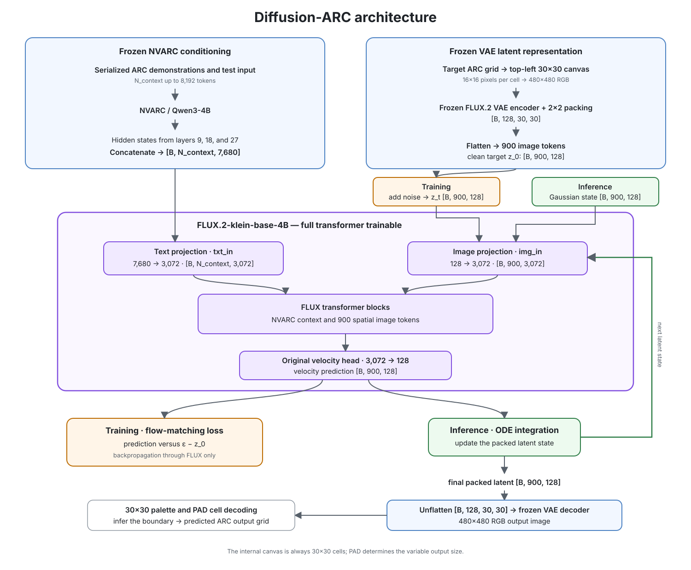

# diffusion-arc

## Overview

Diffusion-ARC develops and evaluates an end-to-end distributed training system
for full-parameter fine-tuning of a pretrained 4B flow transformer. The project
covers the complete workflow from a correct single-GPU baseline to profiling,
validating, and optimizing DDP and FSDP2 training.

ARC-AGI-2 was chosen as an interesting application for the project. It connects
the development of a distributed training system with a concrete research
question: can a pretrained flow transformer, conditioned by NVARC, learn to
solve ARC tasks?

The system combines two complementary components:

1. **NVARC/Qwen3-4B**, an ARC-specialized language model, encodes the serialized
   demonstrations and test input.
2. **FLUX.2-klein-base-4B**, a pretrained flow transformer, uses these
   representations to generate the output grid in latent image space.

Both components connect through the Qwen3-4B model family. FLUX.2 uses hidden
states from Qwen3-4B for text conditioning, while NVARC is an ARC-specialized
fine-tune of Qwen3-4B-Thinking-2507. This shared architecture motivates the
central experiment: keep NVARC frozen and fine-tune the FLUX transformer to
decode NVARC's ARC representations into output grids.

The project has two main goals:

1. Build, profile, and optimize a correct, reproducible, and restartable
   training system for full-parameter FLUX fine-tuning.
2. Use ARC-AGI-2 to test whether a pretrained flow transformer can decode
   NVARC representations into exact output grids.

The distributed training system remains a project result even if the ARC
experiments do not support the initial hypothesis.

## Engineering Questions

The main engineering question is:

> Can an end-to-end training system for FLUX.2-klein-base-4B be made correct,
> reproducible, restartable, measurable, and efficient across single-GPU, DDP,
> and FSDP2 execution?

Supporting questions include:

- How closely do losses, gradients, and parameter updates agree between FP32
  reference steps, BF16 single-GPU training, DDP, and FSDP2 when using the same
  global batch and random seeds?
- Where are time and memory spent across data loading, NVARC conditioning, VAE
  encoding, the FLUX forward and backward passes, communication, optimizer
  steps, and checkpointing?
- What memory and throughput trade-offs result from DDP, FSDP2, activation
  checkpointing, and overlapping computation with communication?
- How do GPU count, batch shape, and NVARC sequence length affect throughput,
  peak memory, and scaling efficiency?
- Can the training instrumentation detect and localize non-finite values, loss
  spikes, unexpected memory growth, stragglers, and throughput regressions?
- Can a run resumed from a distributed checkpoint match an uninterrupted run
  within a defined numerical tolerance?
- Can profiler-guided optimizations improve end-to-end throughput or peak memory
  without reducing numerical agreement or ARC exact-grid accuracy?

## ARC Research Question

> Can a pretrained FLUX transformer decode frozen NVARC representations into
> ARC output grids with higher exact-grid accuracy than NVARC's original
> autoregressive decoding?

## Architecture

The NVARC model and FLUX VAE remain frozen, while the complete FLUX
transformer is trained. The architecture reuses FLUX's native Qwen3
conditioning interface: the original FLUX text encoder concatenates hidden
states from layers 9, 18, and 27, so Diffusion-ARC extracts the same layers
from NVARC. Their combined width of 7,680 matches FLUX's existing `txt_in`
projection and avoids introducing a separate conditioning adapter.

ARC target grids are aligned to the top-left of a fixed 30×30 canvas, padded
with a white sentinel, and rendered as 480×480 RGB images. The frozen FLUX VAE
and its 2×2 latent packing convert each canvas into 900 image tokens, providing
one spatial token for every ARC cell.

The main change to the original FLUX input path is the context length. FLUX's
reference text preparation is capped at 512 tokens, while serialized ARC tasks
may require up to 8,192 tokens. The initial ARC setup uses no visual reference
images, so the longer text context is combined only with the 900 target image
tokens rather than additional reference-image tokens. The resulting sequence
length and its memory and runtime costs must be verified during implementation
and distributed profiling.

The complete initial architecture, training objective, and decoding procedure
are documented in
[`docs/initial-flow-only-architecture.md`](docs/initial-flow-only-architecture.md).

## Distributed Training

The engineering work starts from a verified single-GPU training step and
extends it to DDP and FSDP2 without changing the underlying experiment. NVARC
and the FLUX VAE remain frozen, while the complete FLUX transformer is trained
using BF16 mixed precision.

The training system includes distributed data loading, activation
checkpointing, gradient clipping and non-finite detection, distributed
checkpoint save and resume, and profiling with `torch.profiler` and Nsight
Systems.

Single-GPU, DDP, and FSDP2 execution are compared using the same global batch
size and random seeds. Benchmarks on 1, 2, 4, and 8 GPUs, where the available
single-node hardware permits, report throughput, median and p95 step time, peak
GPU memory, scaling efficiency, communication overhead, and numerical
agreement.

## Evaluation

The evaluation excludes the test-time training and test-time augmentation
commonly used in ARC systems. No task-specific parameter updates, input
transformations, augmentation ensembles, or voting are used. Both the trained
FLUX model and the autoregressive NVARC baseline are evaluated through direct
sampling from the original task input.

The primary results are exact-grid pass@1 and pass@2 accuracy on a held-out
task-level split. Pass@1 uses one sampled output per task. Pass@2 counts a task
as solved if either of two independently sampled outputs exactly matches the
target grid. Augmented variants of held-out tasks must never appear in the
training data.

Per-cell accuracy, output-shape accuracy, flow loss, performance by grid size,
and sensitivity to the number of denoising steps are reported as diagnostic
metrics rather than primary results.

## Milestones

Quantitative acceptance criteria and numerical tolerances are fixed in the run
configuration before the corresponding experiment. Performance and research
milestones do not require a hypothesis-supporting result: findings that reject
an assumption or show no benefit are documented and treated as valid outcomes.

### Milestone 1 — Data Handling and Model Setup

- Load and validate the NVARC, FLUX, and VAE checkpoints.
- Implement ARC task loading, task augmentation, and reproducible dataset
  generation.
- Preserve the source task and augmentation metadata for every generated
  example.
- Implement the deterministic mapping from ARC color IDs to RGB canvases and
  back to ARC grids, including top-left alignment and the white PAD sentinel.
- Build the frozen NVARC conditioning path using hidden states from layers 9,
  18, and 27.
- Connect the NVARC representations to the complete trainable FLUX transformer.
- Encode clean target grids with the frozen VAE and verify all intermediate
  shapes and dtypes.
- Compute the flow-matching loss for one batch and verify that gradients are
  finite and limited to the FLUX transformer.

This milestone is complete when a reproducible dataset can be generated, one
batch can pass through the complete NVARC–FLUX pipeline, and the flow loss can
be backpropagated without updating NVARC or the VAE. Flow timesteps and noise
are sampled during training rather than stored in the dataset.

### Milestone 2 — Reproducible Single-GPU Overfitting Run

- Create a small task-level training subset for the overfitting experiment.
- Run a short BF16 training job on a single GPU against a predefined
  overfitting criterion for the small dataset.
- Support gradient accumulation and record both micro-step and optimizer-step
  behavior.
- Log loss, learning rate, gradient norm, step time, throughput, GPU memory,
  and non-finite values.
- Record seeds, dataset identity, augmentation configuration, checkpoint
  revisions, package versions, precision, and hardware.
- Collect regular `torch.profiler` traces and at least one Nsight Systems trace
  of the complete training step.
- Save checkpoints and generated validation samples during the run.
- Verify repeated runs against predefined reproducibility tolerances.

This milestone is complete when a short, fully logged, and reproducible
single-GPU run meets the documented overfitting criterion and produces decoded
grids that improve according to the predefined metrics.

### Milestone 3 — DDP Correctness and Instrumentation

- Extend the single-GPU training code to DDP without changing the model or
  training objective.
- Implement distributed data loading with deterministic shuffling and
  task-level sample ownership.
- Define the global batch size consistently across GPU count, micro-batch size,
  and gradient accumulation.
- Compare losses, gradients, and parameter updates against the single-GPU
  reference using identical samples and seeds.
- Add rank-aware logging for step time, throughput, memory, gradient norms, and
  non-finite values.
- Profile complete distributed steps with `torch.profiler` and Nsight Systems.
- Measure synchronization time, communication overhead, workload imbalance,
  and stragglers.
- Run a short multi-GPU overfitting experiment and compare its learning
  behavior with the single-GPU run.

This milestone is complete when a DDP run produces updates within the
predefined numerical tolerances, learns on the same small dataset, and provides
enough per-rank telemetry to explain its performance and failures.

### Milestone 4 — FSDP2 Sharding and Memory Scaling

- Apply FSDP2 at FLUX transformer-block boundaries.
- Keep frozen NVARC and VAE placement explicit and outside the sharded optimizer
  state.
- Add mixed-precision policies and activation checkpointing.
- Verify losses, gradients, and parameter updates against the DDP reference.
- Measure parameter, gradient, optimizer-state, activation, and peak-memory
  behavior.
- Profile all-gather, reduce-scatter, resharding, and compute–communication
  overlap.
- Compare different FSDP2 and activation-checkpointing configurations.
- Test longer NVARC sequences and batch shapes that are not practical with DDP.
- Run the same short overfitting experiment used for the single-GPU and DDP
  baselines.

This milestone is complete when FSDP2 matches the validated training behavior
within the predefined numerical tolerances and its memory, performance, and
usable batch-size or sequence-length trade-offs have been measured. A finding
that FSDP2 provides no practical advantage for the tested configurations is a
valid result.

### Milestone 5 — Checkpointing, Resume, and Failure Diagnostics

- Implement distributed checkpoint save and resume for DDP and FSDP2.
- Store model, optimizer, scheduler, RNG, data-loader, sampler, and
  training-progress state.
- Resume gradient accumulation only from a clearly defined optimizer-step
  boundary.
- Compare interrupted and resumed runs with an uninterrupted reference run.
- Verify that the runs match within the predefined numerical tolerances.
- Record checkpoint duration, size, memory use, and per-rank synchronization
  time.
- Detect and report non-finite losses and gradients, loss spikes, unexpected
  memory growth, stragglers, and throughput regressions.
- Add controlled failure tests, including an interrupted run and an incomplete
  or incompatible checkpoint.
- Use profiler traces when normal telemetry cannot explain a failure or
  regression.

This milestone is complete when DDP and FSDP2 runs can be interrupted and
resumed without losing training state, and common numerical, performance, and
checkpoint failures can be localized. Resume with a different strategy or GPU
count is not required.

### Milestone 6 — Scaling and Performance Optimization

- Define short, representative benchmark workloads that exercise the complete
  training pipeline without requiring a full ARC training run.
- Keep the small overfitting setup as a correctness regression test, but use
  representative ARC sequence lengths, batch shapes, and augmentation settings
  for performance measurements.
- Establish fixed benchmark configurations for single GPU, DDP, and FSDP2.
- Benchmark 1, 2, 4, and 8 GPUs where the available single-node hardware
  permits.
- Report throughput, median and p95 step time, peak GPU memory, scaling
  efficiency, and communication overhead.
- Use the telemetry and profiler traces collected throughout the earlier
  milestones to identify the dominant end-to-end bottlenecks.
- Compare DDP and FSDP2 configurations, activation checkpointing, batch shapes,
  gradient accumulation, and NVARC sequence lengths.
- Investigate data loading, frozen NVARC and VAE execution, FLUX forward and
  backward passes, optimizer steps, communication, and checkpointing.
- Optimize only bottlenecks demonstrated by full-step measurements.
- Recheck numerical agreement and short-run learning behavior after every
  material optimization.
- Publish reproducible before-and-after measurements, including optimizations
  that did not improve the complete training step.
- Select the system configuration used for subsequent training experiments.

This milestone is complete when the system has reproducible scaling results,
its dominant bottlenecks are supported by profiler evidence, and the effects of
profiler-guided optimization attempts have been validated without changing the
experiment or its training behavior. A well-supported finding that none of the
tested optimizations improves the complete training step is a valid result.
This is the central engineering result of the project.

### Milestone 7 — Training Recipe Development

- Define the final ARC train and validation split at the task level before
  selecting hyperparameters.
- Use bounded proxy runs that are more representative than the small
  overfitting experiment but cheaper than full training.
- Run limited hyperparameter sweeps over learning rate and schedule, global
  batch size and gradient accumulation, weight decay, flow-timestep sampling,
  augmentation mixture, and optimizer settings.
- Compare runs using validation flow loss, exact-grid accuracy, and decoding
  behavior.
- Check whether promising changes remain consistent across more than one seed.
- Select a training configuration and fixed compute budget.
- Freeze the dataset split, training recipe, and checkpoint-selection rule
  before full training.

This milestone is complete when the full training run has a justified and
reproducible recipe rather than a set of untested hyperparameter choices. The
sweep remains deliberately bounded and is not a separate large-scale HPO
project.

### Milestone 8 — Full ARC Training

- Generate the full training dataset using the frozen task split and selected
  augmentation configuration.
- Train with the recipe selected in Milestone 7 and the validated DDP or FSDP2
  system configuration.
- Use distributed checkpointing, resume, complete logging, and periodic
  profiler samples throughout the run.
- Track learning curves, validation metrics, throughput, and memory use.
- Select the final checkpoint using the predefined validation rule.
- Keep the held-out test tasks unavailable during training, tuning, and
  checkpoint selection.
- Record the complete configuration and artifacts required to reproduce the
  run.

This milestone is complete when a final, reproducibly trained FLUX checkpoint
has been selected without using the test split.

### Milestone 9 — ARC Evaluation

- Evaluate the final FLUX checkpoint and NVARC's autoregressive decoding on the
  same held-out tasks.
- Use direct sampling only, without test-time training, test-time augmentation,
  voting, or task-specific parameter updates.
- Report exact-grid pass@1 and pass@2 as the primary results.
- Analyze per-cell accuracy, output-shape accuracy, grid size, denoising-step
  sensitivity, and common failure modes as diagnostic results.
- Report inference runtime and sampling cost.
- Answer the central research question from the measured results and document
  negative results as clearly as positive ones.

This milestone is complete when the research question can be answered from a
reproducible comparison with NVARC's autoregressive decoding.

### Stretch Milestone — Low-Precision and Kernel Experiments

Only after the nine core milestones:

- evaluate selected FP8 training paths against the BF16 reference,
- measure scaling, accumulation, stability, convergence, and quality trade-offs,
- optimize only demonstrated attention or MLP kernel bottlenecks with Triton,
- and validate kernel microbenchmarks against complete training steps.

Multi-node training remains outside the project scope.

## Initial Non-Goals

The initial project scope does not include:

- fine-tuning NVARC or the FLUX VAE,
- conditioning adapters or task-specific output heads,
- visual reference images or ground-truth output dimensions,
- ARC-style test-time training or test-time augmentation,
- state-of-the-art ARC performance,
- multi-node training.

The distributed training work is limited to a single node. Multi-node
experiments are outside the project scope because their infrastructure cost is
not justified by the current engineering and research goals.
