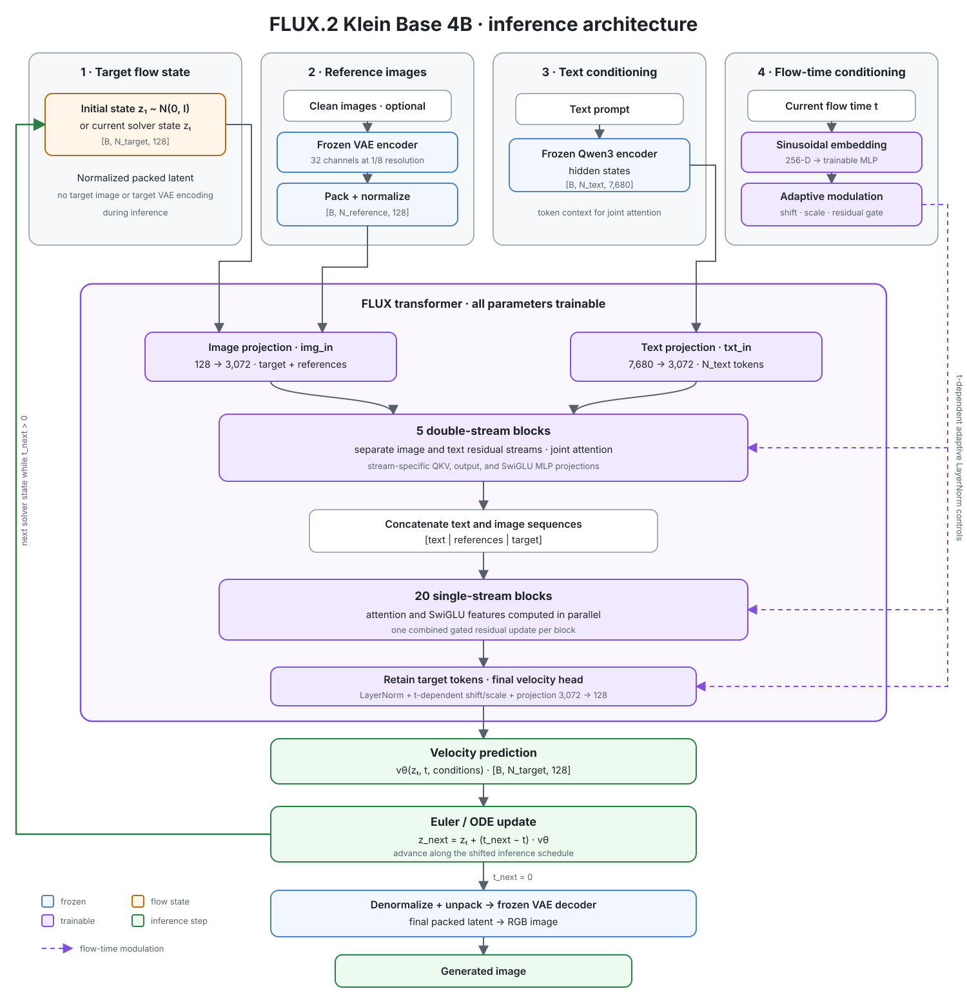
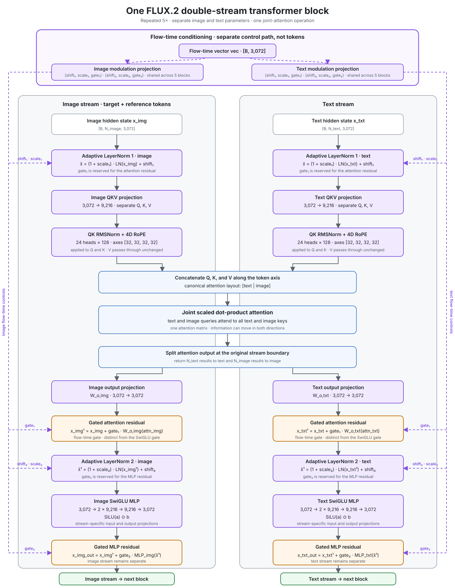
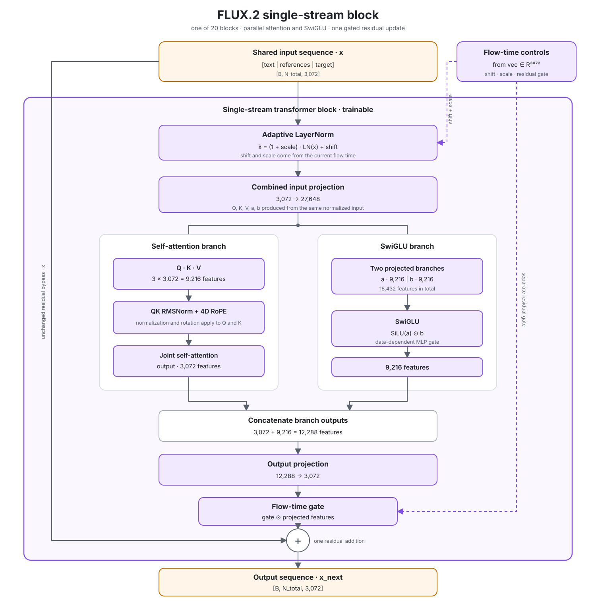
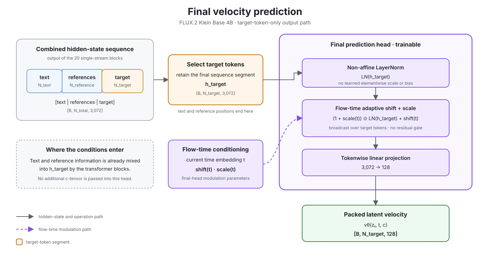

# FLUX.2 Klein Base 4B: Architecture and Flow Matching

## Scope and evidence

This note summarizes the released `FLUX.2-klein-base-4B` implementation and the
rectified-flow interpretation needed to understand its training and inference.
It describes FLUX independently of the ARC-specific architecture in the project
README.

The tensor shapes and block structure below are verified against Black Forest
Labs' official inference implementation and the released model configuration.
The official repository does not contain the original pretraining code.
Consequently, the exact data mixture, timestep distribution, loss weighting,
optimizer, and training curriculum are not public. Sections about the training
objective therefore distinguish the standard rectified-flow formulation from
checkpoint-specific facts that cannot be verified.

## End-to-end view



At inference, the transformer is evaluated repeatedly while an ODE solver moves
the target latent from noise at `t=1` toward a clean latent at `t=0`. The VAE
decoder is used once after the final integration step.

## Released 4B configuration

| Property | `FLUX.2-klein-base-4B` |
| --- | ---: |
| Packed latent width | 128 |
| Text context width | 7,680 |
| Transformer hidden width | 3,072 |
| Attention heads | 24 |
| Head width | 128 |
| Double-stream blocks | 5 |
| Single-stream blocks | 20 |
| MLP ratio | 3 |
| RoPE axes | `[32, 32, 32, 32]` |
| RoPE base `theta` | 2,000 |
| Learned guidance embedding | No |

The native Qwen3 text embedder concatenates hidden states from layers 9, 18,
and 27. For a Qwen3-4B hidden width of 2,560, this produces the transformer's
7,680-dimensional text context. The reference implementation truncates or pads
the text sequence to 512 tokens. This is an implementation limit, not an
attention-theory limit; changing it requires compatible data, memory, position
handling, and fine-tuning.

## VAE, packing, and image tokens

For an RGB image of height `H` and width `W`, the released autoencoder uses the
posterior mean and produces 32 channels at one eighth of the pixel resolution:

\[
x \in \mathbb{R}^{B\times3\times H\times W}
\longrightarrow
z_{\mathrm{vae}}\in
\mathbb{R}^{B\times32\times H/8\times W/8}.
\]

A rearrangement then packs every spatial `2x2` group into the channel
dimension:

\[
[B,32,H/8,W/8]
\longrightarrow
[B,128,H/16,W/16].
\]

This is lossless tensor rearrangement, not another learned compression:

\[
128 = 32 \times 2 \times 2.
\]

The packed channels are normalized with fixed BatchNorm running statistics and
the spatial grid is flattened:

\[
[B,128,H/16,W/16]
\longrightarrow
[B,N_{\mathrm{img}},128],
\qquad
N_{\mathrm{img}}=\frac{H}{16}\frac{W}{16}.
\]

Examples:

| Pixel resolution | Packed grid | Image tokens |
| --- | --- | ---: |
| `1024x1024` | `64x64` | 4,096 |
| `480x480` | `30x30` | 900 |
| `240x240` | `15x15` | 225 |

The requirement that each image dimension be divisible by 16 comes from the
VAE's 8x reduction followed by 2x2 packing, not from RoPE. Decoding reverses
flattening, normalization, and packing, then uses the VAE decoder to recover the
pixel resolution associated with that latent grid.

During inference, the initial target state can be sampled directly as Gaussian
noise in the normalized packed latent space. A pixel-space noise image does not
need to pass through the VAE. Clean target and reference images do require VAE
encoding when their latents are constructed.

## The three token roles

The transformer receives three conceptual token types:

1. **Target image tokens** are the changing flow state. Only their final
   velocity is required.
2. **Reference image tokens** are clean visual conditions encoded by the same
   VAE and input projection.
3. **Text tokens** are contextual embeddings projected from width 7,680 to
   width 3,072.

The image input projection maps `128 -> 3072`; the text input projection maps
`7680 -> 3072`. Once projected, all tokens have the same hidden width, although
the first five blocks still maintain separate text and image streams.

## Flow time and adaptive modulation

The scalar flow time

\[
t_{\mathrm{flow}}\in[0,1]
\]

describes the current noise level of the target latent. It is converted to a
256-dimensional sinusoidal embedding and passed through a two-layer MLP:

\[
[B]\longrightarrow[B,256]\longrightarrow[B,3072].
\]

Call the resulting vector `vec`. Learned projections transform `vec` into
adaptive LayerNorm controls:

- double-stream image modulation: two `(shift, scale, gate)` triples;
- double-stream text modulation: two `(shift, scale, gate)` triples;
- single-stream modulation: one `(shift, scale, gate)` triple;
- final-layer modulation: `(shift, scale)`.

For hidden state `x`, one modulated normalization has the form

\[
\hat{x}=(1+\mathrm{scale})\operatorname{LN}(x)+\mathrm{shift},
\]

and a gated residual update has the form

\[
x_{\mathrm{next}}=x+\mathrm{gate}\cdot f(\hat{x}).
\]

These modulation projections are shared across blocks: one image projection
feeds all five double-stream blocks, one text projection feeds all five, and
one single-stream projection feeds all twenty single-stream blocks. The
attention and MLP weights inside the transformer blocks are not shared.

The projections create 17 modulation vectors per forward pass. Counting their
use across blocks gives `12*5 + 3*20 + 2 = 122` applications, but not 122
different learned projections.

## Five double-stream blocks

Each double-stream block keeps image and text hidden states separate and has
stream-specific QKV, output, and MLP weights. For each stream:



1. adaptive LayerNorm prepares the attention input;
2. a `3072 -> 9216` projection creates Q, K, and V;
3. Q and K receive RMS normalization and multidimensional RoPE;
4. text and image Q/K/V are concatenated for joint attention;
5. the corresponding attention result returns to its original stream;
6. a gated residual applies the attention output;
7. a second adaptive LayerNorm, SwiGLU MLP, and gated residual follow.

Joint attention means that text queries and image queries participate in one
attention operation. The modalities retain separate learned projections and
residual streams, but information can move in both directions.

With an MLP ratio of 3, the hidden MLP width is

\[
3\times3072=9216.
\]

The first MLP projection emits two 9,216-dimensional branches. SwiGLU computes

\[
\operatorname{SiLU}(a)\odot b,
\]

and the result is projected from 9,216 back to 3,072. This data-dependent
SwiGLU gate is distinct from the flow-time residual gate.

## Twenty single-stream blocks

After the double-stream stack, text and image sequences are concatenated. A
single-stream block computes attention and MLP features in parallel from the
same adaptively normalized input.



Its first projection produces:

\[
3\times3072 + 2\times9216 = 27{,}648
\]

values per token:

- 9,216 for Q, K, and V;
- two 9,216-dimensional SwiGLU branches.

Attention produces 3,072 features and the SwiGLU branch produces 9,216. Their
12,288-feature concatenation is projected back to 3,072, multiplied by one
flow-time gate, and added through a single residual connection:

\[
x_{\mathrm{next}}
=x+\mathrm{gate}\cdot
W_{\mathrm{out}}\left(
\operatorname{Attention}(Q,K,V)
\mathbin{\|}\operatorname{SwiGLU}(a,b)
\right).
\]

Thus the double-stream blocks apply attention and MLP sequentially, whereas the
single-stream blocks compute them in parallel and combine them before one
residual update.

## Final velocity head

After the single-stream stack, only the target-token segment is retained by the
model or sampling wrapper. The final layer applies:



1. non-affine LayerNorm;
2. flow-time-dependent shift and scale;
3. a linear projection `3072 -> 128`.

The output has exactly the shape of the packed target latent:

\[
v_\theta(z_t,t,c)\in
\mathbb{R}^{B\times N_{\mathrm{target}}\times128}.
\]

Here `c` is only compact notation for the conditions, such as text and
reference images. It is not one additional tensor with a universally fixed
shape.

## Reference attention: standard and KV-cached paths

The released implementation contains two distinct reference-image paths.
Keeping them separate avoids treating a cache optimization as a universal
property of the model.

### Standard forward path

Reference image tokens are appended to the image sequence. Text and all image
tokens use full joint attention, so every query can attend to every text,
reference, and target key. Reference states are recomputed on every denoising
step. The sampling wrapper keeps the prediction corresponding to the target
segment and discards reference-token outputs.

### KV-cached path

The first step uses the logical sequence:

```text
[text | references | target]
```

Its asymmetric attention behavior is:

| Query tokens | Keys they may attend to |
| --- | --- |
| Text | Text, references, target |
| References | References only |
| Target | Text, references, target |

References use a fixed flow timestep of zero. Because reference queries cannot
depend on the changing target or text stream, their per-block K/V tensors can
be extracted on the first step and reused later. Subsequent steps process text
and target tokens while injecting the cached reference K/V tensors into
attention.

This distinction is especially relevant to the separately released 9B KV
variant. The architectural code exposes the cache path generally, but the
ordinary 4B Base inference path is full attention unless that path is invoked
explicitly.

## Four-dimensional RoPE

Every token receives four position coordinates:

\[
(t_{\mathrm{pos}},h,w,l).
\]

They are independent of the scalar flow time:

- `t_pos` separates target and reference-image planes;
- `h` and `w` locate an image token on its packed spatial grid;
- `l` locates a text token in its sequence.

The official input preparation uses `(0,h,w,0)` for the target image,
`(0,0,0,l)` for text, and time-plane offsets `10, 20, ...` for successive
reference images.

Each attention head is 128-dimensional. FLUX partitions it as
`[32,32,32,32]`, assigning 32 dimensions to each coordinate axis. Each
32-dimensional part contains 16 two-dimensional pairs. For a pair and
frequency \(\omega_k\), RoPE uses the angle

\[
\phi=p\omega_k,\qquad
\omega_k=\theta^{-2k/d},
\]

and applies the rotation

\[
R(\phi)=
\begin{bmatrix}
\cos\phi & -\sin\phi\\
\sin\phi & \cos\phi
\end{bmatrix}
\]

to Q and K, but not V.

The key identity is

\[
(R(p_i)q_i)^\top(R(p_j)k_j)
=q_i^\top R(p_j-p_i)k_j.
\]

Attention can therefore respond to relative coordinate differences. The range
of geometric frequencies lets different pairs represent fine and coarse
positional changes. RoPE provides relative geometry; token projections,
content, stream structure, and any attention mask still determine semantic
roles.

## Rectified-flow training objective

The standard straight probability path between a clean packed latent `z_0` and
Gaussian noise `epsilon` is

\[
z_t=(1-t)z_0+t\epsilon,
\qquad
t\in[0,1].
\]

Under this convention, `t=0` is clean data and `t=1` is noise. Differentiating
the path gives the conditional target velocity

\[
u_t=\frac{dz_t}{dt}=\epsilon-z_0.
\]

It has the same shape as the latent: every scalar in every image token has one
velocity target. A basic flow-matching loss is

\[
\mathcal{L}_{\mathrm{flow}}
=
\mathbb{E}_{z_0,\epsilon,t}
\left[
\left\|
v_\theta(z_t,t,c)-(\epsilon-z_0)
\right\|_2^2
\right].
\]

Although the conditional target velocity is constant along one sampled
straight path, the learned marginal field is a function of the current state,
time, and conditions. Its prediction must therefore be recomputed at every
inference step.

A normal training exposure needs only one sampled `t`, one sampled `epsilon`,
and one transformer forward pass. If the same clean example is encountered
again, new values can be sampled online. Training does not run a complete
denoising trajectory and normally does not decode the predicted latent.

This equation captures the standard rectified-flow objective and is consistent
with the released inference direction. The exact FLUX.2 Klein pretraining
timestep sampler and any loss reweighting are not published in the official
inference repository.

## ODE inference

The learned field defines the ordinary differential equation

\[
\frac{dz}{dt}=v_\theta(z,t,c).
\]

Sampling begins with

\[
z_1\sim\mathcal{N}(0,I)
\]

and integrates backward from `t=1` to `t=0`. The official sampler uses an
Euler update:

\[
z_{t_{\mathrm{next}}}
=
z_t+
(t_{\mathrm{next}}-t)
v_\theta(z_t,t,c).
\]

Because `t_next < t`, the signed step moves opposite the noise-directed
velocity learned under the convention above. In tensor terms, this is simply a
scaled addition between two arrays of shape
`[B, N_target, 128]`.

The released scheduler starts with evenly spaced boundaries but applies a
sequence-length- and step-count-dependent time/SNR shift, so practical
timesteps need not be uniformly spaced. Base checkpoints are intended for
roughly 50-step sampling; the separately distilled Klein checkpoints target
four steps. Fewer arbitrary Euler steps on a base model are possible but are
not equivalent to training or distilling a model for those larger steps.

After the final step, the packed latent is reshaped, denormalized, unpacked to
32 VAE channels, and decoded once into RGB pixels.

## What is verified and what remains unknown

Verified from released code and configuration:

- VAE mean encoding, 32 latent channels, 2x2 packing, and normalization;
- 128-dimensional packed image tokens;
- 3,072 hidden width, 24 heads, 5 double-stream blocks, and 20 single-stream
  blocks;
- stream structure, projections, SwiGLU MLPs, QK normalization, modulation
  sharing, final velocity projection, and four-axis RoPE;
- standard full-attention and optional asymmetric KV-cache paths;
- backward Euler inference and shifted inference schedules;
- 512-token native text preparation in the reference implementation.

Not published in the official inference code:

- the original image/text training corpus and sampling mixture;
- how often individual training items were revisited;
- the exact distribution used to sample training timesteps;
- loss weights or timestep-dependent weighting;
- optimizer, batch size, training duration, and curriculum;
- the complete teacher-student procedure used for distilled variants.

## Primary sources

- [Black Forest Labs FLUX.2 official inference repository](https://github.com/black-forest-labs/flux2)
- [Official transformer implementation](https://github.com/black-forest-labs/flux2/blob/main/src/flux2/model.py)
- [Official autoencoder implementation](https://github.com/black-forest-labs/flux2/blob/main/src/flux2/autoencoder.py)
- [Official sampling and input preparation](https://github.com/black-forest-labs/flux2/blob/main/src/flux2/sampling.py)
- [Official Qwen3 text embedder](https://github.com/black-forest-labs/flux2/blob/main/src/flux2/text_encoder.py)
- [FLUX.2 Klein Base 4B model card](https://huggingface.co/black-forest-labs/FLUX.2-klein-base-4B)
- [Flow Matching for Generative Modeling](https://arxiv.org/abs/2210.02747)
- [Scaling Rectified Flow Transformers for High-Resolution Image Synthesis](https://arxiv.org/abs/2403.03206)
