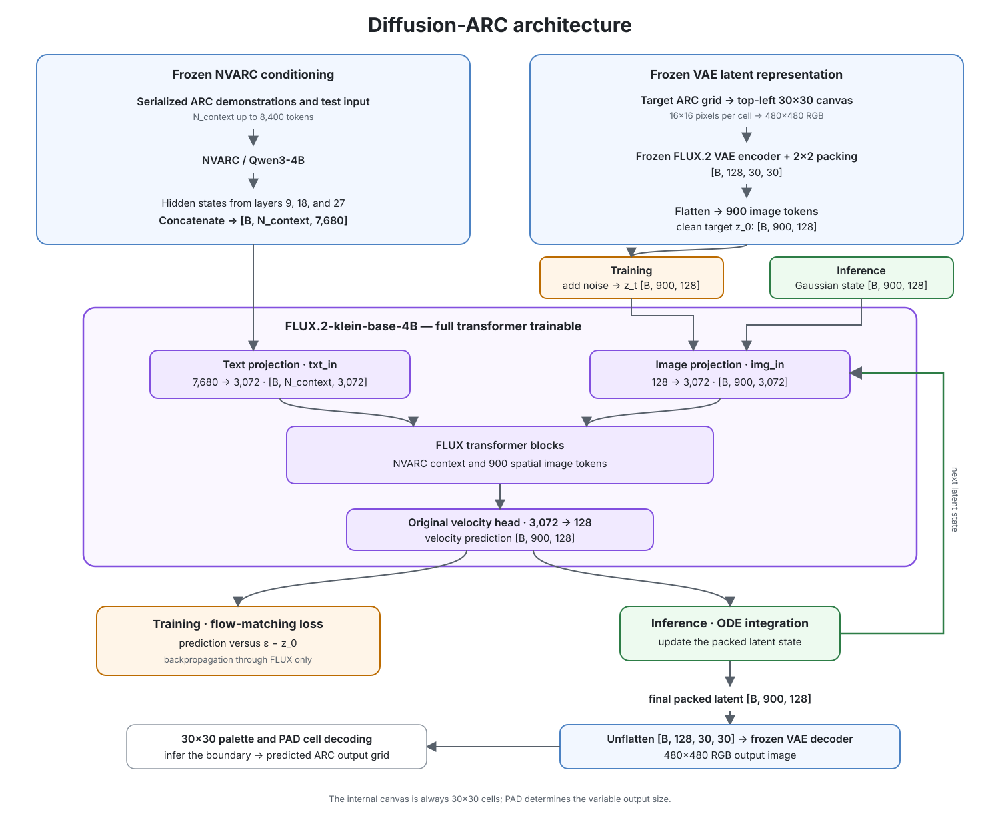

# Initial Flow-Only Architecture

## Status

This document specifies the flow-only architecture used by the nine core
project milestones. The project scope and milestone order are defined in the
root [`README.md`](../../README.md).

## Core hypothesis

The smallest useful test of the project hypothesis is:

> Can a fully fine-tuned pretrained FLUX.2 Klein Base 4B transformer, directly
> conditioned on frozen NVARC hidden states, generate a packed latent that
> decodes to the exact ARC output grid using only its original flow-matching
> objective?

The first version changes the conditioning source and task representation, but
does not change the internal FLUX transformer or add a task-specific learned
output head.

## End-to-end architecture



No visual reference images are used in the initial architecture. All
demonstrations and the test input reach FLUX through NVARC conditioning.

## NVARC conditioning

NVARC remains frozen. The input contains only the serialized ARC demonstrations
and test input available at inference time. The correct test output must never
be included in the conditioning sequence.

The initial interface extracts the NVARC layers corresponding to the layers
used by the native FLUX Qwen3 embedder. If each selected layer has width 2,560,
concatenating three layers produces:

\[
3 \times 2560 = 7680.
\]

The result is passed directly to FLUX's existing text projection:

\[
[B,N_{\mathrm{context}},7680]
\longrightarrow
[B,N_{\mathrm{context}},3072].
\]

There is no learned NVARC-to-FLUX adapter. A linear `7680 -> 7680` adapter
followed by the trainable FLUX `7680 -> 3072` projection would be functionally
redundant for the initial full-parameter fine-tuning experiment.

The implementation must verify the actual NVARC checkpoint, hidden-layer
indices, tensor width, tokenization, dtype, and sequence length. ARC examples
have variable context lengths and may require up to 8,400 tokens, replacing the
512-token truncation in the reference FLUX text-preparation path. This changes
the supported input length, not the transformer block design.

Text position IDs use the sequence coordinate:

\[
(t_{\mathrm{pos}},h,w,l)=(0,0,0,l).
\]

## Fixed ARC canvas

Every target is represented on a fixed `30x30` cell canvas. A grid of height
`h` and width `w` is placed at the top-left corner:

```text
columns 0 ... w-1 | remaining columns
------------------+------------------
ARC output cells  | PAD
------------------+------------------
PAD in all remaining rows
```

The valid region contains ARC color IDs `0` through `9`, rendered through the
fixed `greedy_rgb_maximin_v1` target palette selected by the measured
[VAE palette experiment](../experiments/vae/palette-and-roundtrip.md):

```text
0 #000000   1 #0055FF   2 #55FF00   3 #FF0055   4 #00FFAA
5 #AA00FF   6 #FFAA00   7 #AAAAAA   8 #555555   9 #0000AA
```

Every cell outside the valid rectangle uses class `10`, the RGB-white
`#FFFFFF` PAD sentinel. White is not one of the ten target colors and has
already been exercised as the padding color in the VAE experiments.

Each ARC cell is rendered as a solid `16x16` pixel block:

\[
30 \times 16 = 480.
\]

The resulting `480x480` RGB image passes through the frozen FLUX.2 VAE:

```text
[B, 3, 480, 480]
        |
        v
[B, 32, 60, 60]       VAE latent
        |
        v
[B, 128, 30, 30]      normalized 2x2-packed latent
        |
        v
[B, 900, 128]         flattened transformer state
```

This establishes a direct one-to-one alignment between an ARC cell and a FLUX
image token. Image position IDs are:

\[
(t_{\mathrm{pos}},h,w,l)=(0,h,w,0),
\qquad
h,w\in\{0,\ldots,29\}.
\]

## Flow-only training

Let `z_0` be the packed latent of the correct padded target canvas. For each
training exposure, sample:

\[
\epsilon\sim\mathcal{N}(0,I),
\qquad
t\in[0,1],
\]

and construct:

\[
z_t=(1-t)z_0+t\epsilon.
\]

The straight-path velocity target is:

\[
u_t=\epsilon-z_0.
\]

The complete FLUX transformer, including its existing final velocity
projection, predicts:

\[
v_\theta(z_t,t,c)
\in\mathbb{R}^{B\times900\times128},
\]

where `c` denotes the frozen NVARC conditioning. The only initial training
objective is:

\[
\mathcal{L}_{\mathrm{flow}}
=
\mathbb{E}
\left[
\left\|
v_\theta(z_t,t,c)-(\epsilon-z_0)
\right\|_2^2
\right].
\]

There is no color cross-entropy, shape loss, auxiliary decoder, or second
learned head.

## Inference

Inference starts from:

\[
z_1\sim\mathcal{N}(0,I),
\qquad
z_1\in\mathbb{R}^{B\times900\times128}.
\]

The original FLUX velocity head is evaluated repeatedly while an ODE solver
integrates from `t=1` to `t=0`. For an Euler step:

\[
z_{t_{\mathrm{next}}}
=
z_t+
(t_{\mathrm{next}}-t)
v_\theta(z_t,t,c).
\]

After the last step, the packed latent is reshaped to `[B,128,30,30]`,
unpacked, denormalized, and decoded once by the frozen VAE into a `480x480` RGB
image.

## Deterministic grid and shape decoding

The RGB result is converted into an ARC answer without a learned prediction
head:

1. divide the image into `30x30` non-overlapping `16x16` pixel cells;
2. compute the mean RGB value of each cell;
3. assign the nearest prototype among the ten ARC colors plus white PAD;
4. infer the output extent from the top-left-aligned non-PAD region;
5. crop that rectangle and return its ARC color IDs.

The inferred dimensions are:

\[
\hat h
=
1+\max\{r:\text{row }r\text{ contains a non-PAD cell}\},
\]

\[
\hat w
=
1+\max\{c:\text{column }c\text{ contains a non-PAD cell}\}.
\]

Equivalently, for a structurally valid prediction, `h` and `w` are the first
fully padded row and column. An all-PAD canvas or a PAD prediction inside the
inferred rectangle is invalid. The implementation must not silently replace an
invalid structural prediction with a ground-truth dimension or color.

The model therefore learns output content and output shape through the same
flow objective. Shape is represented visually by the generated PAD boundary,
not supplied externally and not predicted by a separate head.

## Frozen and trainable boundaries

Frozen:

- NVARC / Qwen3-4B;
- FLUX.2 VAE encoder and decoder.

Trainable:

- the complete FLUX.2 Klein Base 4B transformer;
- the existing FLUX image and text projections;
- the existing double- and single-stream blocks;
- the existing final velocity head.

No newly initialized trainable module is required for the initial
architecture.

## Implementation and validation requirements

### Milestone 1 interface validation

- verify the exact NVARC tokenizer, checkpoint, selected layers, tensor width,
  dtype, and maximum context length;
- prove that the test output is absent from NVARC conditioning;
- verify the direct `[B,N_context,7680] -> [B,N_context,3072]` interface;
- assert the VAE and NVARC frozen state;
- assert all canvas, latent, token, position-ID, and velocity shapes;
- reproduce deterministic top-left padding and grid decoding;
- compute the flow-matching loss and backpropagate through FLUX only.

### Milestone 2 learning validation

- overfit the predefined small ARC dataset;
- evaluate the run against a predefined overfitting criterion;
- report decoded-grid metrics including predicted output dimensions;
- distinguish flow-model error from VAE and deterministic readout error.

## Primary risks

- NVARC hidden states may have a different distribution from the native Qwen3
  states expected by pretrained FLUX, despite matching tensor width.
- Contexts up to 8,400 tokens are far longer than the native 512-token
  reference path and may require substantial fine-tuning to use effectively.
- Continuous latent MSE does not directly optimize discrete exact-grid
  accuracy.
- A single incorrect non-PAD cell outside the true rectangle can change the
  inferred output dimensions.
- The VAE and RGB readout may introduce errors that are separate from ARC
  reasoning quality.

These are measurements to make, not reasons to add auxiliary components before
the simplest hypothesis has been tested.

## Out-of-scope architecture variants

Possible variants outside the current project scope include:

- a residual or bottleneck NVARC-to-FLUX adapter;
- a discrete ARC color head;
- combined flow and color heads;
- an explicit output-shape head;
- alternative deterministic or learned latent readouts;
- compact visual reference canvases.

These variants are not part of the nine core milestones. They may be revisited
only through an explicit scope change after the flow-only architecture has been
evaluated.

## Supporting documents

- [Project scope and milestones](../../README.md)
- [Architecture diagram](diagrams/architecture.svg)
- [FLUX.2 Klein architecture and flow matching](flux2-klein-architecture.md)
- [FLUX.2 VAE smoke test](../experiments/vae/smoke-test.md)
- [FLUX.2 VAE ARC palette experiments](../experiments/vae/palette-and-roundtrip.md)
- [FLUX target-image encoding](../training/flux-image-encoding.md)
- [NVARC overview](nvarc-overview.md)
