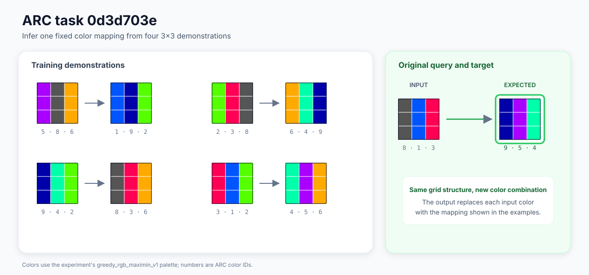
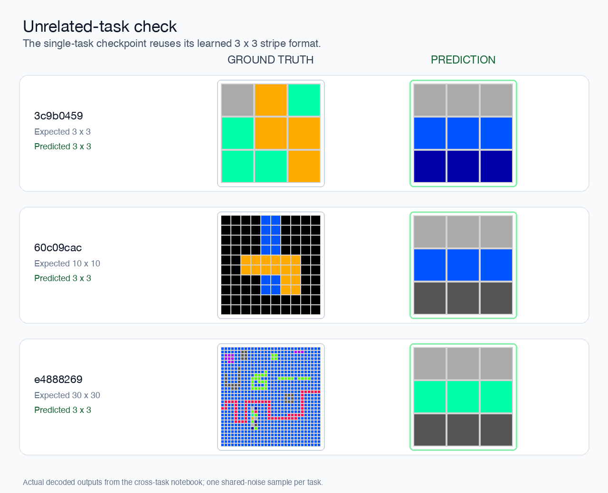

# Overfitting Investigation

## Question

> Can a pretrained FLUX transformer, conditioned by NVARC, learn an ARC task?

## Short answer

Yes. After 4,096 cumulative updates, the model solved both trained and unseen
augmentations of task `0d3d703e` with high exact-grid accuracy. This shows that
it learned the task's transformation rather than only reproducing one fixed
output. As expected for a single-task overfitting experiment, it did not
generalize to unrelated ARC tasks.

The successful checkpoint reached 30/32 exact-grid pass@2 on sampled training
views, 30/32 on unseen augmentations of the same task, and 1/1 on the original
view.



Task `0d3d703e` consists only of 3x3 grids and applies a fixed color mapping
learned from the four demonstrations. The overfitting experiments used many
augmented presentations of this same underlying task.

## What we did

We kept the project's original architecture unchanged throughout. The
experiments below changed only the data regime, timestep sampling, loss
weighting, and training duration.

### 1. Starting with eight tasks

We began with an intentionally ambitious eight-task "Hail Mary." Instead of
first proving that the model could memorize one output, we immediately asked it
to learn 512 augmented sequences drawn from eight different ARC tasks. The
first run used 832 optimizer updates. We then repeated the experiment as a
longer 2,496-update run.

Neither run solved any of the eight tasks. The longer run produced valid grids
and plausible output dimensions more often, which showed that the pipeline was
learning some output structure. It still did not learn the task content.

**Outcome: partial signal, but no solved task.**

### 2. Trying to rescue the checkpoint at inference time

Before changing training, we tried different inference schedules, more
denoising steps, and restart sampling on the longer checkpoint. The restart
experiment was conceptually inspired by the recursive latent refinement in the
[ARChitects' 2025 masked-diffusion approach](https://lambdalabsml.github.io/ARC2025_Solution_by_the_ARChitects/),
but it was not a reproduction of their token-space method: we partially
re-noised completed FLUX image latents and integrated them back to `t=0`.

None of these changes produced an exact solution. A more elaborate sampler
could not compensate for the velocity field the transformer had learned.

**Outcome: no improvement. Inference was not the main bottleneck.**

### 3. Reducing the problem to one task

After the eight-task pilots failed, we reduced the experiment to the simplest
useful question: can the transformer learn task `0d3d703e` at all?

The new pool still contained 512 different augmentations of the task. At the
same time, we changed the supervision scheme. Unlike the eight-task pilots,
which trained several prefix targets from each sequence, this experiment
trained only the final target after all four demonstrations. This removed
potentially underdetermined intermediate targets and reduced the pool from
1,664 targets in the eight-task pilot to 512 final targets. With an optimizer
batch size of eight, one complete pass required only 64 updates.

We used this smaller setup to test another possible bottleneck. Although the
true output was only 3x3, the normal representation expanded it to a padded
30x30 canvas: nine actual grid positions surrounded by 891 padding positions.
We therefore compared the normal representation with a diagnostic compact 3x3
version to see whether the padding overhead was preventing early learning.

As expected, the compact representation ran faster because it used only 9
instead of 900 spatial FLUX tokens. Neither variant produced an exact output
after this single pass. The experiment was therefore too short to determine
whether padding affected longer-term learnability, and subsequent experiments
returned to the required 30x30 representation.

**Outcome: the one-pass comparison was inconclusive as a learning ablation.**

### 4. Proving that exact generation was possible

The next experiments stopped presenting every augmentation only once. Instead,
they repeatedly trained one, then two, and finally eight fixed variants while
sampling different noise and flow timesteps.

The model learned the single fixed variant exactly. With two and eight fixed
variants, it learned some outputs and changed its predictions when the NVARC
conditions were exchanged while noise and timestep stayed fixed. This showed
that NVARC was actively influencing output selection rather than being ignored.
The same checkpoints still failed on every unseen augmentation.

**Outcome: the first exact success and evidence of conditional routing, but no
augmentation transfer.**

### 5. Diagnosing why generation still failed

A partial-denoising diagnosis showed that the fixed-condition checkpoint could
recover most targets when generation started halfway along the flow trajectory.
It recovered only one target when starting from pure noise at `t=1`, as normal
inference does. Later runs therefore placed more training weight on this start
of the trajectory.

The preflight also exposed a separate VAE edge case: one of 17 planned targets
did not round-trip exactly when embedded in the heavily padded 30x30 canvas. A
broader audit confirmed that this was a narrow, deterministic limitation for a
small subset of tiny grids, not a general VAE failure. Later pools included
only variants that the frozen VAE could reconstruct exactly, while normal raw
exact-grid scoring remained unchanged.

**Outcome: two concrete failure sources were isolated instead of treating the
whole pipeline as broken.**

### 6. Training one task across many augmentations

The final experiment family used 512 VAE-safe training augmentations, 128
VAE-safe holdout augmentations, and the original view. The holdout variants had
different color mappings, demonstration orders, and augmentation keys, but
represented the same underlying task and received no transformer updates.

We also changed how the flow-matching loss treated the padded canvas. Instead
of averaging all 900 positions together, the loss averaged the output grid,
its immediate padding boundary, and the remaining outer padding separately,
then weighted them `0.6`, `0.3`, and `0.1`. This prevented hundreds of easy
padding positions from dominating the nine cells of the 3x3 output.

The unweighted checkpoint still showed almost no exact success after 2,048
updates. The fresh region-weighted checkpoint likewise had no exact outputs at
512, 1,536, or 2,048 updates. Early region-weighted training used one explicit
`t=1` update for every seven regular updates; later continuations balanced
endpoint and regular updates equally. Although exact-grid accuracy remained
flat at first, the loss and generated stripe structure continued to improve,
so the checkpoint was trained to 4,096 cumulative updates.

That longer continuation produced the decisive result:

| Panel | Exact pass@1 | Exact pass@2 | Correct shape | Mean pass@1 cell accuracy |
| --- | ---: | ---: | ---: | ---: |
| 32 sampled training views | 30/32 | 30/32 | 32/32 | 97.92% |
| 32 unseen same-task augmentations | 28/32 | 30/32 | 32/32 | 96.18% |
| Original view | 1/1 | 1/1 | 1/1 | 100% |

The four remaining pass@2 failures were still valid 3x3 stripe grids with only
one incorrect stripe color. The checkpoint therefore learned more than one
stored output: it applied the task's color and geometry transformation to many
augmentations it had never seen during training.

The 4,096 updates describe a cumulative transformer-weight lineage rather than
one uninterrupted optimizer run, because each continuation restored the
transformer but restarted AdamW and RNG state. There was also no full generation
evaluation between steps 2,048 and 4,096, so the exact point at which the new
behavior emerged is unknown.

**Outcome: successful generalization within one ARC task.**

### 7. Checking unrelated tasks

Finally, the successful checkpoint generated one shared-noise sample for seven
unrelated ARC queries, including tasks with expected outputs of size 10x10,
20x20, and 30x30. None was solved. Every query instead produced a 3x3 stripe
grid from the output family learned for `0d3d703e`.



The figure shows three representative cases from the seven-task diagnostic.
Even when the expected grid became much larger, the checkpoint retained the
learned 3x3 form. This was the expected failure mode for a model deliberately
overfitted to one task, not a surprising regression.

**Outcome: expected failure outside the trained task and a clear boundary on
what the experiment demonstrated.**

## What we learned

The strongest supported conclusions are:

- The proposed frozen-NVARC to trainable-FLUX path can learn an ARC output
  transformation.
- One-condition memorization is easy, but learning several conditional outputs
  from pure noise needs much more training.
- NVARC conditioning is active and changes output selection.
- The start of the flow trajectory was a major weakness in early checkpoints.
- The fixed VAE is highly accurate overall, with a small padding-sensitive
  failure regime that must stay visible during evaluation.
- Same-task augmentation transfer became strong only after substantially more
  training than the first pilots.
- A model trained on one task learns that task's output family and should not
  be expected to infer unrelated ARC rules.

What remains unclear:

- whether region weighting, the endpoint schedule, or simply more updates was
  most important;
- the minimum number of steps needed for the final behavior;
- whether the result reproduces with a different training seed;
- whether the same setup works for tasks with other output sizes and
  structures;
- whether multi-task training can retain conditional routing without
  collapsing to one output family.

## Main artifacts

### Early pilots and sampler checks

- [Pilot v1 documentation](protocols/eight-task-pilot-v1.md) and
  [report](../../../experiments/results/single-gpu-overfitting-pilot/20260825T060523831464Z/report.json)
- [Pilot v2 documentation](protocols/eight-task-pilot-v2.md) and
  [report](../../../experiments/results/single-gpu-overfitting-pilot/20260825T150620231361Z/report.json)
- [Inference-schedule report](../../../experiments/results/single-gpu-overfitting-pilot/20260825T150620231361Z/inference-schedule-comparisons/20260825T181919730623Z/report.json)
- [Restart-sampling report](../../../experiments/results/single-gpu-overfitting-pilot/20260825T150620231361Z/restart-sampling-comparisons/20260825T203225808608Z/report.json)

### Single-task controls and diagnosis

- [Spatial-ablation documentation](protocols/spatial-ablation.md) and
  [report](../../../experiments/results/single-task-spatial-overfitting-ablation/20260825T203819809220Z/report.json)
- [Conditioning-ladder documentation](protocols/conditioning-ladder.md) and
  [report](../../../experiments/results/single-task-conditioning-overfitting-ladder/20260826T001237667541Z/report.json)
- [Flow-trajectory diagnosis](../../../experiments/results/conditioning-ladder-checkpoint-diagnosis/20260826T022945063611Z/report.json)
- [Incomplete endpoint run](../../../experiments/results/single-task-conditioning-endpoint-overfitting/20260826T033633550571Z/report.json)
- [VAE audit documentation](../vae/palette-and-roundtrip.md) and
  [report](../../../experiments/results/vae_training_output_roundtrip_audit_colab/20260826T212221277717Z/report.json)

### Augmentation-generalization checkpoint lines

- [Fresh unweighted run](../../../experiments/results/single-task-augmentation-generalization-overfitting/20260826T155954304798Z/report.json)
- [Unweighted continuation to step 2,048](../../../experiments/results/single-task-augmentation-generalization-overfitting/20260826T172117710559Z/report.json)
- [Fresh region-weighted run](../../../experiments/results/single-task-augmentation-generalization-overfitting/20260826T215440643526Z/report.json)
- [Region-weighted continuation to step 1,536](../../../experiments/results/single-task-augmentation-generalization-overfitting/20260826T231644245954Z/report.json)
- [Endpoint-balanced continuation to step 2,048](../../../experiments/results/single-task-augmentation-generalization-overfitting/20260827T003543625091Z/report.json)
- [Successful continuation to step 4,096](../../../experiments/results/single-task-augmentation-generalization-overfitting/20260827T011822050154Z/report.json)

The cross-task report is stored in the Modal volume at:

```text
results/single-task-checkpoint-cross-task-diagnosis/
20260827T024030502160Z/report.json
```

The notebooks used to create these runs are located under
`experiments/training/`, `experiments/inference/`, and `experiments/vae/`.
