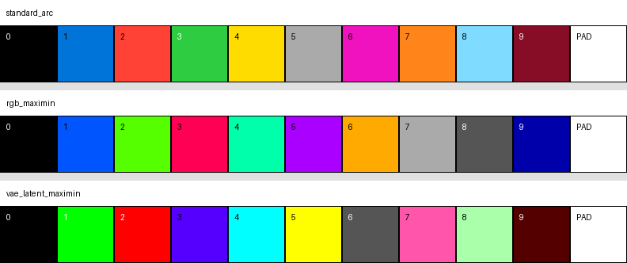
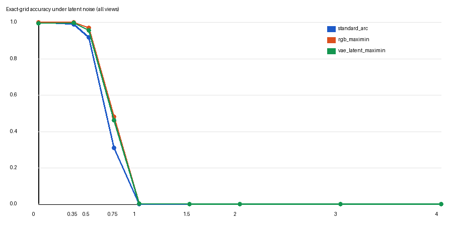
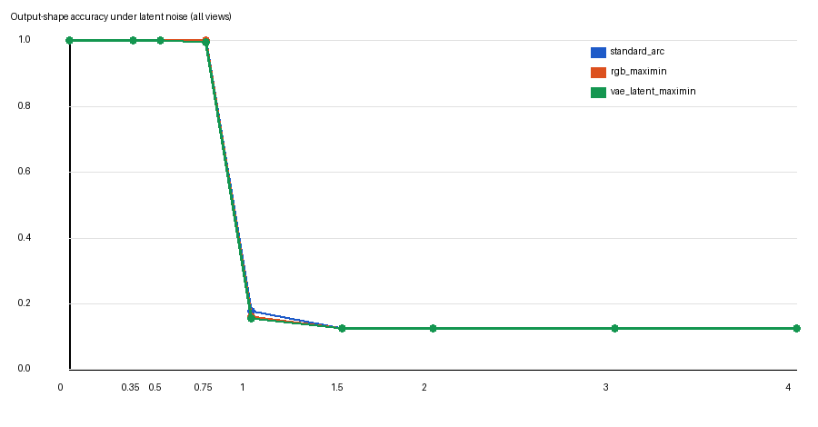
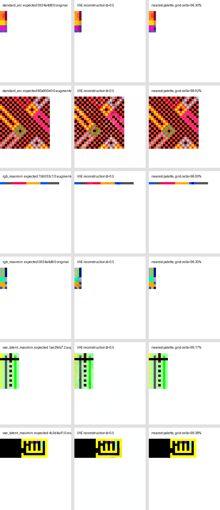

# FLUX.2 VAE ARC palette experiments

## Status

This note records the palette experiments used to evaluate RGB encodings for
ARC target canvases. It covers the synthetic pilot, the subsequent experiment
on labelled public ARC development outputs, and a post-hoc analysis of the
greedy maximin search.

The measured experiments identify the greedy RGB-maximin palette as the leading
tested candidate. It is selected as the fixed Milestone 1 target representation
under the identifier `greedy_rgb_maximin_v1`. This selection does not claim
global or end-to-end optimality: an exactly optimal RGB candidate has not been
evaluated through the VAE, and no palette has been compared in a FLUX training
run.

The authoritative project scope and milestone order remain in
[`README.md`](../../README.md).

## Question

ARC color IDs need not use the conventional human-facing ARC colors when they
are rendered as images. The relevant representation question is whether a
different fixed mapping from IDs 0-9 to RGB values makes target grids easier for
the frozen FLUX.2 VAE to preserve and for the trainable FLUX transformer to
generate.

These experiments isolate the VAE side of that question. They compare:

1. the conventional ARC palette;
2. a greedy RGB-maximin palette selected by Euclidean distance in RGB space;
3. a greedy VAE-latent-maximin palette selected by Euclidean distance between
   transformer-facing VAE latent prototypes.

They do not test whether a palette improves FLUX learning or end-to-end ARC
accuracy.

## Protocol and leakage boundary

The labelled public ARC `evaluation` directory is treated as a development set.
Its outputs may inform representation and training-recipe decisions, while the
hidden Kaggle private set remains the final system-level evaluation. Results in
this document must therefore not be presented as independent held-out ARC
generalization results.

This distinction is particularly important because the frozen NVARC checkpoint
is already contaminated with respect to public ARC-AGI-2 evaluation tasks, as
documented in [`nvarc-overview.md`](../architecture/nvarc-overview.md). NVARC is not executed in
the palette experiment, but the same public set cannot later be reclassified as
an untouched final benchmark after it has been used for palette selection.

## Shared representation and runtime

Both experiments use the initial architecture's fixed rendering contract:

- 30x30 class canvas;
- true grid aligned to the top-left;
- class 10 reserved for the white `(255, 255, 255)` PAD sentinel;
- 16 pixels per ARC cell and a 480x480 RGB image;
- frozen FLUX.2 VAE in evaluation mode and FP32;
- posterior mode rather than posterior sampling;
- packed and normalized transformer-facing latent shape `[128, 30, 30]`.

The saved runs used an NVIDIA A100-SXM4-40GB, PyTorch `2.11.0+cu128`, and VAE
weights with SHA-256
`ca70d2202afe6415bdbcb8793ba8cd99fd159cfe6192381504d6c4d3036e0f04`.
The experiment seed was `20260813`.

The notebooks and machine-readable reports are:

- [synthetic pilot notebook](../../experiments/vae_palette_experiment.ipynb)
- [synthetic pilot metrics](../../experiments/results/vae-palette-experiment/metrics.json)
- [real-grid notebook](../../experiments/vae_palette_real_evaluation.ipynb)
- [real-grid metrics](../../experiments/results/vae-palette-real-evaluation/metrics.json)

## Candidate construction

The search space contains the 64 RGB colors formed by the Cartesian product of
the channel levels `{0, 85, 170, 255}`. White is excluded from the ten ARC
colors and retained as a fixed reference because it is the PAD sentinel.

For the two maximin candidates, the stored experiments use greedy farthest-point
selection. Given the already selected references `S`, each remaining candidate
`c` receives the score

```text
score(c) = min(distance(c, s) for s in S)
```

and the candidate with the largest score is added. White is the first fixed
reference. This maximizes the current worst-case distance at each step, not the
global worst-case distance of the final ten-color set.

RGB maximin applies this rule to normalized RGB vectors. VAE-latent maximin
renders four seeded, class-balanced context mosaics for all 64 candidates,
computes a 128-dimensional mean latent prototype for each color, and applies the
same rule to those prototypes.

### Tested palettes

| ARC ID | Standard ARC | Greedy RGB maximin | Greedy VAE-latent maximin |
| ---: | --- | --- | --- |
| 0 | `#000000` | `#000000` | `#000000` |
| 1 | `#0074D9` | `#0055FF` | `#00FF00` |
| 2 | `#FF4136` | `#55FF00` | `#FF0000` |
| 3 | `#2ECC40` | `#FF0055` | `#5500FF` |
| 4 | `#FFDC00` | `#00FFAA` | `#00FFFF` |
| 5 | `#AAAAAA` | `#AA00FF` | `#FFFF00` |
| 6 | `#F012BE` | `#FFAA00` | `#555555` |
| 7 | `#FF851B` | `#AAAAAA` | `#FF55AA` |
| 8 | `#7FDBFF` | `#555555` | `#AAFFAA` |
| 9 | `#870C25` | `#0000AA` | `#550000` |
| PAD | `#FFFFFF` | `#FFFFFF` | `#FFFFFF` |



## Synthetic pilot

The pilot used six diagnostic 30x30 patterns: color bands, isolated cells, thin
lines, a checkerboard, a balanced random mosaic, and a smaller top-left grid
surrounded by PAD. It evaluated clean VAE round trips, latent prototype
separation, and normalized transformer-latent noise at sigma values `0.05`,
`0.10`, `0.20`, and `0.35`.

All three palettes reconstructed all six clean patterns exactly and remained at
six of six exact grids for every tested noise value. The noise sweep therefore
hit a ceiling and could not distinguish the candidates.

| Palette | Clean exact grids | Cell accuracy through sigma 0.35 | Minimum class distance | Minimum PAD distance | Worst margin / spread |
| --- | ---: | ---: | ---: | ---: | ---: |
| Standard ARC | 6/6 | 100% | 3.0054 | 5.9972 | 0.8211 |
| Greedy RGB maximin | 6/6 | 100% | 3.9333 | 5.9623 | 1.0832 |
| Greedy VAE-latent maximin | 6/6 | 100% | 5.1209 | 5.4031 | 1.4111 |

The latent metrics suggested that both constructed palettes increased class
separation. VAE-latent maximin had the largest class margin but reduced the
minimum distance to PAD. The pilot alone did not justify changing the palette,
which motivated the real-grid and stronger-noise experiment.

## Public-development real-grid experiment

### Data and augmentation

The local public development data contained:

- 120 tasks;
- 167 labelled query outputs;
- 75 tasks with one output, 43 with two, and two with three;
- output heights from 2 to 30 and widths from 1 to 30;
- output areas from 16 to 900 cells;
- combined dataset SHA-256
  `1acd8f5e3559183e1b06d332a5c1d98f0941796b63821bf860c93466ebdfdbd9`.

Each output contributed two views:

1. its unmodified public-development output;
2. one deterministic augmented copy with a complete color permutation and a
   geometry selected by rotating through the eight production geometries.

This produced 334 views. Seven geometries occurred 21 times and `FD2` occurred
20 times in the augmented half. Every non-zero noise level used three
independent, deterministic noise realizations shared across palettes. The
complete sweep used sigma values `0`, `0.35`, `0.50`, `0.75`, `1.0`, `1.5`,
`2.0`, `3.0`, and `4.0`.

### Clean round trip

| Palette | Exact grids | Shape accuracy | True-grid cell accuracy | PAD precision | PAD recall |
| --- | ---: | ---: | ---: | ---: | ---: |
| Standard ARC | 334/334 | 100% | 100% | 100% | 100% |
| Greedy RGB maximin | 334/334 | 100% | 100% | 100% | 100% |
| Greedy VAE-latent maximin | 333/334 | 100% | 99.9993% | 100% | 100% |

The VAE-latent-maximin failure occurred in augmented view
`f931b4a8:1:augmented`, a 4x4 output transformed with `FH`. One expected class-9
cell was classified as class 0, leaving the shape correct but reducing that
grid's cell accuracy to 93.75%. The other two palettes had no clean failures.

### Exact-grid robustness

The table reports the mean exact-grid accuracy over the three noise repeats.
Standard deviations are included where the repeats differed.

| Sigma | Standard ARC | Greedy RGB maximin | Greedy VAE-latent maximin |
| ---: | ---: | ---: | ---: |
| 0 | 100.00% | 100.00% | 99.70% |
| 0.35 | 99.10% | **100.00%** | 99.90% +/- 0.14% |
| 0.50 | 91.92% +/- 1.49% | **97.01% +/- 0.49%** | 95.81% +/- 0.49% |
| 0.75 | 31.14% +/- 1.27% | **48.10% +/- 1.35%** | 46.21% +/- 0.56% |
| 1.00 | 0.10% +/- 0.14% | 0.30% +/- 0.24% | 0.40% +/- 0.14% |



Greedy RGB maximin was the strongest tested palette throughout the meaningful
transition at sigma `0.35`, `0.50`, and `0.75`. At sigma `1.0`, all candidates
were effectively unusable as exact-grid representations.

### Cell and shape behavior

| Sigma | Metric | Standard ARC | Greedy RGB maximin | Greedy VAE-latent maximin |
| ---: | --- | ---: | ---: | ---: |
| 0.50 | True-grid cell accuracy | 99.9731% | **99.9905%** | 99.9872% |
| 0.50 | Shape accuracy | 100% | 100% | 100% |
| 0.75 | True-grid cell accuracy | 99.2601% | **99.6144%** | 99.5730% |
| 0.75 | Shape accuracy | 100% | 100% | 99.7006% |
| 1.00 | True-grid cell accuracy | 93.7615% | 95.7135% | **96.0326%** |
| 1.00 | Shape accuracy | **17.8643%** | 16.0679% | 15.5689% |

The small cell-level differences become large exact-grid differences because a
single wrong cell invalidates an entire ARC output. At sigma `1.0`, the
remaining high cell accuracy is misleading: exact-grid accuracy is near zero
and PAD-boundary failures have already collapsed inferred output shapes.



The failure gallery confirms that errors concentrate around small structures,
thin color regions, and cell boundaries rather than producing uniform RGB
drift.



### Focused post-hoc summary

A trapezoidal area under the exact-grid curve was computed from the stored
summary values to compare only the range in which outputs remained useful.
This is a post-hoc diagnostic, not a preregistered acceptance metric.

| Range | Standard ARC | Greedy RGB maximin | Greedy VAE-latent maximin |
| --- | ---: | ---: | ---: |
| Sigma 0-0.75 | 0.8607 | **0.9055** | 0.8981 |
| Sigma 0-1.00 | 0.6846 | **0.7396** | 0.7319 |

These focused summaries support greedy RGB maximin among the three measured
palettes.

## Interpretation of the stored decision rule

The notebook's stored automatic decision marks both candidates as not
qualifying. That Boolean should not be used as the final palette conclusion.

For greedy RGB maximin, the rule requires both mean exact-grid and mean
true-grid cell accuracy across every non-zero noise value to improve over the
standard palette. It weights sigma values `1.5`, `2.0`, `3.0`, and `4.0`
equally with the informative transition values. Exact-grid accuracy is already
zero for every palette throughout those high-noise points, while shape accuracy
has collapsed. Differences in cell classification there describe severely
corrupted decoded images rather than usable final latents.

For VAE-latent maximin, the rule correctly rejects the candidate because it is
not clean-safe. Its stronger latent prototype margin did not prevent the real
4x4 clean failure. This demonstrates that prototype separation is an
insufficient selection criterion by itself because it does not capture every
spatial and contextual VAE effect.

## Post-hoc exact RGB maximin analysis

The greedy RGB search is not globally optimal on the discrete 64-color lattice.
With white fixed as PAD, the exact problem is to choose ten of the 63 remaining
colors and maximize the minimum pairwise RGB distance, including every selected
color's distance to white.

A post-hoc local threshold-and-clique enumeration found:

- `127,805,525,001` possible unordered ten-color subsets before pruning;
- greedy palette minimum distance: `120.2082`;
- global optimum minimum distance: `147.2243`;
- relative increase in the geometric worst-case distance: approximately 22.5%;
- 115,367 unordered color sets attaining the global optimum;
- 19,825 sets after treating RGB-channel permutations as equivalent.

One globally optimal set found by lexicographic tie-breaking was:

```text
#000000  #0000AA  #00AA00  #00AAAA  #555555
#5555FF  #55FF55  #55FFFF  #AA0000  #AA00AA
```

This set is only an example. The large number of optimal sets shows that the
minimum RGB distance does not identify a unique palette or a unique assignment
to ARC IDs. A defensible follow-up would first enforce the globally optimal RGB
distance, then use VAE latent separation as a secondary criterion, and finally
test only the best small number of candidates on real grids.

The exact enumeration was run as an ad-hoc local analysis after the saved
notebook experiments. Its implementation and output are not currently stored
as a committed reproducibility artifact. The counts and example palette must be
regenerated in a persistent script or notebook before they are used as final
experimental evidence.

## Current decision

The evidence supports the following bounded conclusion:

- The conventional ARC palette is clean-safe but less robust in the measured
  exact-grid transition region.
- Greedy RGB maximin is clean-safe and is the leading palette actually tested
  through the real-grid VAE sweep.
- Greedy VAE-latent maximin should not be used because it produced a clean
  error.
- No palette should yet be described as globally or end-to-end optimal.

Greedy RGB maximin is therefore fixed as `greedy_rgb_maximin_v1` for Milestone
1. Before expensive training, one optional bounded follow-up can compare it
against a single globally RGB-optimal candidate chosen with a VAE secondary
criterion. That comparison should use the informative sigma range `0`, `0.35`,
`0.50`, `0.75`, and `1.0`, require 334/334 clean exact grids, and reject any
candidate that worsens shape or PAD behavior. Adopting a different candidate
would require a new explicit palette identifier rather than silently changing
the current mapping.

Regardless of that result, the selected palette should remain a hypothesis
until it is compared against the conventional palette in a small fixed FLUX
training A/B experiment.

## Limitations

- Isotropic Gaussian perturbations of clean transformer-facing latents do not
  reproduce the structured errors of a trained flow transformer.
- The experiment validates VAE representation robustness, not FLUX learning,
  NVARC conditioning, or ARC task solving.
- Each public output received only one deterministic augmented view. This gives
  balanced geometry coverage but does not exhaust color assignments or spatial
  contexts.
- The local public dataset contains 167 labelled outputs, whereas the separate
  NVARC benchmark notes describe a 172-output evaluation artifact. The recorded
  SHA-256 identifies the exact 167-output data version used here; the two
  artifacts must not be assumed identical.
- Full-canvas cell accuracy is dominated by PAD for small outputs. Exact-grid,
  inferred shape, true-grid cell accuracy, and PAD metrics must be interpreted
  together.
- Palette construction and the real-grid experiment each use a fixed search or
  augmentation seed. The noise experiment uses three repeats but does not
  measure sensitivity to palette-search contexts.
- The public labelled outputs are development data and cannot provide the final
  independent quality result.

## Reproduction checklist

1. Use the pinned VAE weight hash and an FP32 VAE in evaluation mode.
2. Run the synthetic notebook from top to bottom and compare its report with
   the saved synthetic metrics.
3. Provide the fingerprinted 120-task public development directory and run the
   real-grid notebook from top to bottom.
4. Confirm 167 source outputs, 334 total views, and the expected dataset hash.
5. Compare the newly generated JSON metrics and figures with the saved result
   directories.
6. Treat any future exact-global palette search as a separate experiment with a
   persistent implementation, configuration, and output artifact.
