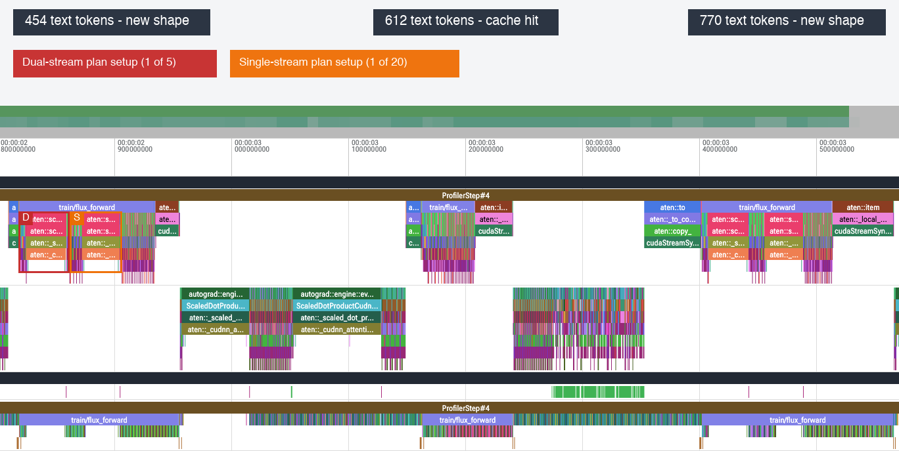

# Performance Benchmarks

This report compares the completed single-GPU training variants and explains
their measured performance and remaining costs. B3 records the next implemented
NVARC changes; its full-pipeline benchmark is pending.

## Benchmark variants

| Variant | Status | NVARC source batch | VAE microbatch | FLUX microbatch | Optimizer batch | Length policy | Target order |
| --- | --- | ---: | ---: | ---: | ---: | --- | --- |
| B0 | Completed | 1 | 1 | 1 | 48 | Exact prefix length | FIFO |
| B1 | Completed | 16 | 48 | 1 | 48 | Fixed bucket padding | FIFO |
| B2 | Completed | 2, 4, 8 within 16-source windows | 48 | 1, 2, 4 | 48 | Scheduled bucket shapes | FIFO membership; reordered within each step |
| B3 (NVARC component) | Implemented; benchmark pending | 16 packed sources | 48 | 1, 2, 4 (B2 policy) | 48 | Unpadded NVARC; FLUX bucket shapes | Same optimizer-batch membership |

B0 establishes the baseline. B1 combines larger fixed preparation batches
with reusable attention shapes. B2 reduces NVARC padding, schedules larger
FLUX microbatches, and overlaps CPU data preparation with GPU work.

[B3](#b3-nvarc-packing-and-early-exit) replaces NVARC bucket scheduling with
one unpadded FA3 forward and stops after the last required hidden-state layer.
The [bucket and alignment](nvarc-batch-shapes.md) and
[packed attention](nvarc-packing.md) diagnostics document the supporting evidence.

## Shared benchmark setup

### Dataset

- Source: `nvarc_train_arc_agi_1_training_only`, containing 14,490 synthetic
  tasks whose parents come only from the official ARC-AGI-1 training split.
- Benchmark: 960 distinct tasks selected by a seeded shuffle of sorted IDs.
- One variant per task, with identity geometry and a random color permutation.
- Five distinct pairs per variant: two demonstrations and three open targets.
- Seed `167` fixes task selection, pair selection/order, and source order.
- Maximum consumed NVARC prefix: 8,400 tokens; each target adds 900 image tokens.

The same variants are reused in every repetition: 160 sources for warm-up and
800 for measurement. Selection is random, without length balancing or
filtering. The final target output is excluded from the NVARC input.
The [dataset preparation script](../../scripts/data/prepare_nvarc_benchmark.py)
verifies parent membership in the training split and records the selected data.

### Hardware and training

The completed B0–B2 benchmarks use one NVIDIA H200 with 139.80 GiB device memory, eight allocated
CPU cores, and 64 GiB host RAM. The software environment is PyTorch 2.13.0,
CUDA 13.0, Transformers 4.56.1, Diffusers 0.39.0, and Accelerate 1.12.0.

NVARC remains frozen in BF16 and the VAE remains frozen in FP32. The complete
FLUX transformer is trained with FP32 parameters and BF16 compute. Activation
checkpointing is disabled. Each optimizer update contains the same 48 targets
from 16 sources, with unchanged optimizer-batch membership and per-target loss
weighting. B0 and B1 execute targets in FIFO order; B2 may reorder execution
within an already selected optimizer batch.

AdamW uses a peak learning rate of `1e-5`, linear warm-up over 213 updates,
then cosine decay to zero at update 7,245. This fixed horizon is separate from
benchmark timing warm-up; all benchmark updates remain in LR warm-up.
The linked variant configs specify the remaining optimizer settings.

### Protocol

| Item | Value |
| --- | ---: |
| Independent repetitions | 3 |
| Warm-up steps per repetition | 10 |
| Measured steps per repetition | 50 |
| Total executed steps | 180 |
| Total measured steps | 150 |
| Measured target executions | 7,200 |

Each repetition starts in a fresh process from the same checkpoint, optimizer
initialization, seed, and data order. A measured step spans data loading,
NVARC and VAE preparation, buffering, FLUX forward/backward, gradient handling,
and the optimizer update. CUDA synchronization brackets the measurement;
model and data initialization are excluded.

Results report median and p95 step latency, target throughput, and peak
allocated/reserved GPU memory over the pooled measured steps. Allocated memory
tracks live PyTorch allocations; reserved memory also includes allocator-held
blocks available for reuse. Neither includes every allocation outside PyTorch.

### Profiling

Separate seven-step runs use two wait steps, two profiler warm-up steps, and
three active steps, recording optimizer steps 5–7. They use each variant's
workload and enable CPU/CUDA tracing without shape, memory, or
stack recording. Profiler overhead affects timing, so phase measurements
explain the mechanism while the unprofiled benchmark measures overall speed.
The B2 trace predates its final gradient-release change, as noted below.

Phase timings distinguish **activity**, the union of recorded GPU kernel,
memory-copy, and memory-set intervals within a GPU range, from **gaps**, the
remaining time inside that range: **total range = activity + gaps**. Activity
includes padding work and is not a measure of useful FLOPs or SM utilization.

Configs:
[B0 profiler](https://github.com/joshuakauling/diffusion-arc/blob/db6d49f/configs/training/profiling/single_gpu_b0_torch_profile.json),
[B1 profiler](https://github.com/joshuakauling/diffusion-arc/blob/db6d49f/configs/training/profiling/single_gpu_b1_torch_profile.json),
and [B2 profiler](https://github.com/joshuakauling/diffusion-arc/blob/db6d49f/configs/training/profiling/single_gpu_b2_torch_profile.json).

### Comparison and reproducibility

The completed B0–B2 benchmarks keep the dataset, optimizer-batch membership, loss normalization,
precision, optimizer schedule, software, and hardware allocation fixed.
Step records were checked for matching source order, target counts, real
prefix lengths, learning rates, and data hashes. Pooled and per-repetition
summaries were independently recomputed from those records.

Run manifests retain commands, resolved configs, source revisions, and
environment details. The reported runs included uncommitted source changes, so the
recorded base commits alone do not identify the executed code. Checkpoint
weight contents were not hashed; exact checkpoint identity remains a
reproducibility limitation.

## B0 — Exact-length FIFO baseline

The [B0 config](https://github.com/joshuakauling/diffusion-arc/blob/db6d49f/configs/training/benchmarks/single_gpu_b0.json) processes
one NVARC source, one VAE image, and one FLUX target at a time. FLUX uses exact
text-prefix lengths; the optimizer accumulates 48 targets in FIFO order.

### Benchmark result

| Median step | p95 step | Targets/s | Peak allocated | Peak reserved |
| ---: | ---: | ---: | ---: | ---: |
| 15.45 s | 17.59 s | 3.094 | 113.91 GiB | 138.12 GiB |

All repetitions completed, including inputs reaching 8,400 tokens.
Benchmark run: `20260903T230458451916Z`.

### Profiler observation: cuDNN attention-plan setup

Three consecutive FLUX microbatches in the first active step illustrate the
bottleneck. Their text prefixes contain 454, 612, and 770 tokens, each
combined with the fixed 900 image tokens.

| Text prefix | FLUX GPU range | Recorded GPU activity | Range without GPU activity |
| ---: | ---: | ---: | ---: |
| 454 | 119.9 ms | 31.2 ms | 88.7 ms |
| 612 | 48.4 ms | 34.5 ms | 13.9 ms |
| 770 | 127.3 ms | 37.0 ms | 90.3 ms |

The 612-token prefix had already occurred in optimizer step 1, microbatch 34;
the other two lengths were new. GPU activity grows slightly across these
examples, while the new lengths have much larger gaps.

Across all 144 active forwards, every one of the 128 previously unseen prefix
lengths had two long `aten::_cudnn_attention_forward` calls; none of the 16
previously seen lengths did. Every forward still launched 25 attention
kernels.

The two setup sites are the first attention call in each block family:
five dual-stream blocks followed by twenty single-stream blocks. Their QKV
layouts differ. PyTorch's cuDNN attention cache includes dimensions and strides,
and a cache miss builds a new graph and execution plan. The red and orange
callouts mark the inferred setup sites. See the
[cuDNN MHA implementation](https://github.com/pytorch/pytorch/blob/v2.13.0/aten/src/ATen/native/cudnn/MHA.cpp#L1341-L1382).

The optimization opportunity is therefore to reuse a limited set of attention
shapes across different real prefix lengths.

## B1 — Bucketed fixed-batch single-GPU pipeline

B1 addresses repeated attention-plan setup and the many small preparation
calls in B0:

- NVARC encodes 16 sources together, followed by one VAE batch of their
  48 targets. NVARC-to-VAE preparation remains coupled.
- NVARC pads each source batch to the smallest configured boundary covering
  its longest real source. FLUX independently pads each target's text prefix
  to its next boundary, retaining a FLUX microbatch size of one.
- Padding is masked. FIFO order, the 48-target optimizer-batch membership,
  and loss weighting remain unchanged.

The [B1 config](https://github.com/joshuakauling/diffusion-arc/blob/db6d49f/configs/training/benchmarks/single_gpu_b1.json) fixes these
batch sizes and boundaries. The [bucket policy](b1-bucket-policy.md) documents
the seven NVARC and 19 FLUX boundaries, the input-length histogram, and their
padding/setup-cost trade-off.

### Preliminary NVARC capacity probe

The [capacity diagnostic](../../scripts/diagnostics/probe_nvarc_batch_capacity.py)
tested synthetic sources with 8,400 real tokens while all models, initialized
optimizer state, gradients, and conservative buffer reserves were resident.
With one repetition per candidate, 29 sources succeeded and 30 ran out of
memory. At batch size 16, peak allocated/reserved memory was 98.54/110.23 GiB.

This established a capacity bound for the synthetic workload, rather than a
throughput-optimal batch size. It did not exercise mixed-length padding masks
or complete NVARC-to-VAE preparation. The B1 benchmark below tested the actual
coupled pipeline, including the largest bucket.

### B1 benchmark result

| Metric | B0 | B1 | Change |
| --- | ---: | ---: | ---: |
| Median optimizer step | 15.45 s | 13.91 s | -10.0% |
| p95 optimizer step | 17.59 s | 15.77 s | -10.3% |
| Targets/s | 3.094 | 3.461 | +11.9% |
| Peak allocated | 113.91 GiB | 113.90 GiB | Approximately unchanged |
| Peak reserved | 138.12 GiB | 118.84 GiB | -19.28 GiB (-14.0%) |

B1 improves complete-pipeline throughput by **11.9%**. Batching and bucket
padding changed together, so this result measures their combined effect.
The memory reduction is in reserved allocator memory; peak allocated tensor
memory is essentially unchanged.

| B1 repetition | Measured steps | Median step | p95 step | Targets/s |
| --- | ---: | ---: | ---: | ---: |
| 1 | 50 | 13.904 s | 15.747 s | 3.465 |
| 2 | 50 | 13.929 s | 15.767 s | 3.460 |
| 3 | 50 | 13.927 s | 15.771 s | 3.460 |

All repetitions completed without OOM, including the 8,400-token NVARC bucket
at step 31. Benchmark run: `20260905T040037141298Z`.

Across 180 matched updates, the mean absolute step-loss difference was
0.000102, with a maximum of 0.000676. Small numerical differences are expected
when changing batch shapes in mixed precision; see
[PyTorch's numerical accuracy notes](https://docs.pytorch.org/docs/main/notes/numerical_accuracy.html#batched-computations-or-slice-computations).
The loss comparison alone does not establish gradient/update equivalence;
equivalent long-term training behavior and ARC quality were not evaluated.

### B1 profiler findings: activity, gaps, and total ranges

The table reports seconds per optimizer step, averaging the three active
steps. Range durations and activity unions are summed per phase, then divided
by three. Values are rounded independently; **Change total** compares B1's
total GPU range with B0's using unrounded values. Negative changes mean shorter
ranges.

| Phase | Activity B0 | Activity B1 | Gaps B0 | Gaps B1 | Total B0 | Total B1 | Change total |
| --- | ---: | ---: | ---: | ---: | ---: | ---: | ---: |
| NVARC | 0.698 | 2.198 | 0.743 | 0.016 | 1.440 | 2.214 | +53.7% |
| VAE | 0.632 | 0.374 | 0.030 | 0.001 | 0.662 | 0.375 | -43.4% |
| FLUX forward | 2.657 | 2.824 | 3.400 | 0.409 | 6.057 | 3.233 | -46.6% |
| FLUX backward (reconstructed) | 6.013 | 6.380 | 2.910 | 0.323 | 8.923 | 6.702 | -24.9% |

**NVARC's total range increases by 53.7%** even though its gaps nearly
disappear. Fixed FIFO groups of 16 process 4,386,048 padded token positions
for 2,050,665 real positions during benchmark measurement: **2.14x the
real-token count**. The active profiler window has a 2.26x ratio. This extra
padding is consistent with GPU activity rising from 0.70 to 2.20 s per step;
the position ratios are not FLOP or runtime multipliers.

Mixed-length padding also changes NVARC's attention path: Transformers builds
an explicit mask and repeats K/V heads instead of requesting native grouped
query attention. The trace does not isolate these costs from the extra token
positions. See the [mask construction](https://github.com/huggingface/transformers/blob/v4.56.1/src/transformers/masking_utils.py)
and [SDPA adapter](https://github.com/huggingface/transformers/blob/v4.56.1/src/transformers/integrations/sdpa_attention.py).
Changing mask values at a fixed shape does not itself require new plans;
the [cuDNN cache key](https://github.com/pytorch/pytorch/blob/v2.13.0/aten/src/ATen/native/cudnn/MHA.cpp)
records mask presence, dimensions, and strides rather than individual values.

**VAE's total range decreases by 43.4%.** Encoding 48 images per call reduces
recorded GPU activity from 0.63 to 0.37 s per step compared with B0's
individual-image calls.

FLUX forward changes from approximately `2.66 + 3.40 = 6.06 s` to
`2.82 + 0.41 = 3.23 s`: **46.6% less total range time**. Backward changes
from `6.01 + 2.91 = 8.92 s` to `6.38 + 0.32 = 6.70 s`: **24.9% less**.
Both perform slightly more recorded GPU work, consistent with added padding,
but the reduction in gaps dominates. Padding's isolated cost was not measured.

Backward lacks a named profiler range. Its bounds were reconstructed for each
microbatch from the first to last GPU activity attributed to the autograd
worker through CUDA correlation IDs. The 144 non-overlapping spans include
loss-gradient propagation and parameter-gradient accumulation, but exclude
time outside those GPU bounds. They do not measure the full Python
`.backward()` call. The phase table also omits CPU preparation and optimizer
work, so it is not a decomposition of benchmark wall time.

The attention backend remains cuDNN. The following counts use only
`aten::_cudnn_attention_forward` and `aten::_cudnn_attention_backward` CPU
events, excluding their enclosing wrappers. A long call exceeds 20 ms.

| Attention calls across all three active steps | B0 total | B0 long | B1 total | B1 long |
| --- | ---: | ---: | ---: | ---: |
| FLUX forward | 3,600 | 256 | 3,600 | 2 |
| FLUX backward | 3,600 | 256 | 3,600 | 2 |
| NVARC forward | 1,728 | 45 | 108 | 0 |

FLUX retains the same number of attention calls while nearly eliminating the
long setup calls in both passes. This supports plan reuse as the explanation
for the reduced gaps. CPU call durations overlap GPU work and cannot be added
as separate savings.

The early trace overrepresents B0's first-use shapes: 88.9% of its active
forwards introduce a new prefix length, compared with 62.0% during the full
measurement window. B1 has already used 16 of 19 buckets before profiling;
only the 256-token bucket is new in the active window. The large early phase
improvement therefore does not imply the same percentage gain over the full
benchmark.

### Data-loading observation

Data loading fetches 16 samples synchronously before NVARC preparation,
taking 0.171 s of CPU range time per step. This is not a measurement of GPU
idle time.

## B2 — Length-aware dynamic-batch single-GPU pipeline

B2 addresses B1's NVARC padding and singleton FLUX calls while preserving
the same 48-target optimizer batches:

- Within each consecutive 16-source window, NVARC uses catalog batches of
  2, 4, or 8 sources. Scheduling minimizes padded positions plus a fixed
  per-call penalty. Outputs return to logical source order.
- VAE encoding follows all NVARC groups and processes the window's 48 targets
  together. Its batch size is independent of the physical NVARC batches.
- FLUX schedules the selected 48 targets into catalog microbatches of 1, 2,
  or 4, minimizing the sum of measured per-shape forward/backward times.
  Flow noise and timesteps are assigned in original target order; loss means
  are weighted by each microbatch's share of the optimizer batch.
- Two CPU workers prefetch samples in order. In the final implementation,
  gradients are released after each optimizer batch, before the next frozen
  preparation phase. The tokenizer accepts the full 9,330-token training
  prompt; the consumed NVARC prefix remains limited to 8,400 tokens.

The [B2 config](https://github.com/joshuakauling/diffusion-arc/blob/db6d49f/configs/training/benchmarks/single_gpu_b2.json) combines
the [NVARC scheduling and prefetch policy](b2-preparation-policy.md) with the
[measured FLUX shape catalog](flux-batch-shapes.md). Reordering stays within
each preparation window or optimizer batch; there are no cross-step bucket
queues or changes to optimizer-batch membership.

### B2 benchmark result

| Metric | B1 | B2 | Change |
| --- | ---: | ---: | ---: |
| Median optimizer step | 13.91 s | 11.32 s | -18.6% |
| p95 optimizer step | 15.77 s | 13.47 s | -14.6% |
| Targets/s | 3.461 | 4.201 | +21.4% |
| Peak allocated | 113.90 GiB | 126.48 GiB | +12.58 GiB (+11.0%) |
| Peak reserved | 118.84 GiB | 133.06 GiB | +14.23 GiB (+12.0%) |

B2 improves complete-pipeline throughput by **21.4% over B1** and **35.8%
over B0**, using more peak GPU memory than B1. These gains measure NVARC
scheduling, preparation decoupling, CPU prefetch, FLUX batching, and gradient
release together; their individual runtime contributions were not isolated.

| B2 repetition | Measured steps | Median step | p95 step | Targets/s |
| --- | ---: | ---: | ---: | ---: |
| 1 | 50 | 11.271 s | 13.491 s | 4.206 |
| 2 | 50 | 11.331 s | 13.343 s | 4.197 |
| 3 | 50 | 11.371 s | 13.463 s | 4.199 |

All three repetitions completed, including 8,400-token inputs.
Benchmark run: `20260907T164538783729Z`.
An earlier run exposed internally recovered cuDNN workspace warnings; the
reported benchmark completed without those warnings after moving gradient
release to the end of each optimizer batch.

Source identities, target-prefix lengths, target counts, learning rates, and
dataset hashes match B1. Across 180 matched updates, the mean absolute
step-loss difference is **0.0000444**, with a maximum of **0.000236**.
This checks loss agreement for the benchmark, not full-model gradient/update
equivalence or long-term training quality.

### Executed batching and padding

These values come from the 50 measured steps per repetition; real source and
target lengths are identical across variants and repetitions.

| Work per optimizer step | B1 | B2 |
| --- | ---: | ---: |
| Mean NVARC calls | 1.00 | 4.14 |
| NVARC padded / real token positions | 2.14x | 1.22x |
| Mean FLUX microbatches | 48.00 | 18.68 |
| FLUX text padding above real positions | 7.88% | 10.14% |

Smaller NVARC groups reduce total padded positions by **42.8%** despite
requiring more calls. FLUX uses **61.1% fewer microbatches**, accepting some
additional text padding to combine targets. These are workload counts,
not FLOP or runtime multipliers. Both schedulers were fitted to this benchmark
subset; their performance on the full training distribution remains unmeasured.

### B2 profiler findings: activity, gaps, and total ranges

**This diagnostic trace predates the final gradient-release change.** It
captures the same NVARC/FLUX scheduling, VAE batching, and CPU prefetch, but
its memory-pressure effects must not be attributed to the final benchmark.
The table uses the same three active steps and GPU-range method as B1;
recomputing B1 with this method reproduces the preceding B1 table.

| Phase | Activity B1 | Activity B2 | Gaps B1 | Gaps B2 | Total B1 | Total B2 | Change total |
| --- | ---: | ---: | ---: | ---: | ---: | ---: | ---: |
| NVARC | 2.198 | 1.081 | 0.016 | 0.355 | 2.214 | 1.436 | -35.1% |
| VAE | 0.374 | 0.390 | 0.001 | 0.051 | 0.375 | 0.440 | +17.4% |
| FLUX forward | 2.824 | 2.674 | 0.409 | 0.198 | 3.233 | 2.872 | -11.2% |
| FLUX backward (reconstructed) | 6.380 | 5.325 | 0.323 | 0.629 | 6.702 | 5.954 | -11.2% |

Values are seconds per optimizer step; changes use unrounded totals.
Backward uses 52 non-overlapping spans reconstructed from GPU activity
attributed to the autograd worker, matching the 52 FLUX microbatches in this
window. As in B1, this is not a decomposition of benchmark wall time.

**NVARC GPU activity falls by 50.8%.** Grouping similar source lengths reduces
padding work. The active window executes 11 NVARC calls instead of three;
larger gaps offset part of the activity reduction, leaving a **35.1% shorter
total range**. Five NVARC attention CPU calls still exceed 20 ms, versus none
in B1, consistent with residual plan setup in this early window. The trace does
not isolate setup from other dispatch or allocation gaps.

**FLUX forward and backward ranges each shrink by 11.2%.** Forward activity
decreases by 5.3% and its gaps roughly halve. Backward activity decreases by
16.5%, while its gaps increase, partially offsetting that gain. Across the
active window, each pass performs 1,300 attention calls rather than 3,600;
eight calls per pass exceed 20 ms, versus two in B1. The window averages
17.33 microbatches per step, compared with 18.68 during benchmark measurement,
so its percentages are not estimates of the full benchmark's phase gains.

**VAE keeps the same 48-image batch.** Its older B2 trace includes additional
allocation and [plan-retry](https://github.com/pytorch/pytorch/blob/v2.13.0/aten/src/ATen/native/cudnn/Conv_v8.cpp#L973-L1046)
gaps, consistent with the recovered cuDNN workspace
warnings. The **17.4% longer range** describes that diagnostic run; it is not
a measured VAE regression after the final gradient-release change.

DataLoader retrieval still makes **16 calls per step**, but their combined
CPU range falls from **0.171 s to 0.009 s** with ordered background prefetch.
The work moves to workers rather than disappearing. These CPU ranges do not
measure GPU idle time or independently establish the end-to-end prefetch gain.

## B3 — NVARC packing and early exit

**Status: the NVARC changes are implemented; the complete B3 benchmark and
profiler comparison are pending.** Two changes reduce frozen preparation work:

- **FA3 Varlen without padding.** The 16 sources in a preparation window are
  concatenated end to end and encoded in one call. Cumulative source boundaries
  isolate causal attention, and position IDs restart for each source. This
  removes NVARC length buckets, scheduling and padding, including alignment.
- **Stop after block 27.** The encoder calls the original Qwen embeddings,
  RoPE and first 27 decoder blocks directly, retaining only the outputs of
  blocks 9, 18 and 27. Blocks 28–36, final normalization and the language-model
  head are skipped. Bypassing the outer Hugging Face forward preserves block
  27's original intermediate state instead of normalizing it as a final output.

The [current integration config](../../configs/training/benchmarks/single_gpu_b3_nvarc.json)
keeps B2's FLUX scheduling while the separate FLUX work is evaluated. VAE
batch size 48, CPU prefetch, optimizer-batch membership and per-target loss
weighting remain unchanged. The full NVARC checkpoint remains loaded; unused
parameter tensors have not been removed from GPU memory.

The relevant baseline is **B2's padded, scheduled NVARC path using PyTorch
SDPA with cuDNN**. The [component comparison](nvarc-packing.md#comparison-with-the-previous-implementation)
suggests **44.8–51.0% less isolated NVARC time** with unpadded FA3 across three
16-source windows. This combines the backend change, removed padding and one
forward instead of three to five. The old-path diagnostic used synthetic token
contents and the FA3 diagnostic used real inputs at the same source lengths,
so this is an indicative comparison, not a controlled full-pipeline B3 result.

Alignment gave no consistent benefit. All of those component measurements
executed 36 blocks and the language-model head, so they do not include the
early exit. Skipping nine blocks removes **25% of decoder-block execution**,
without establishing a 25% reduction in total NVARC or optimizer-step time.

Local tiny-Qwen tests produce bitwise-equal selected states against a complete
forward using the same reference attention and verify that later blocks,
final normalization and the output head are not called. These CPU tests do
not execute the FA3 CUDA kernel. Combined GPU latency, peak memory and
full-pipeline loss/gradient agreement remain to be measured. See the
[encoder documentation](../training/nvarc-batch-runner.md) for implementation
and validation details.
