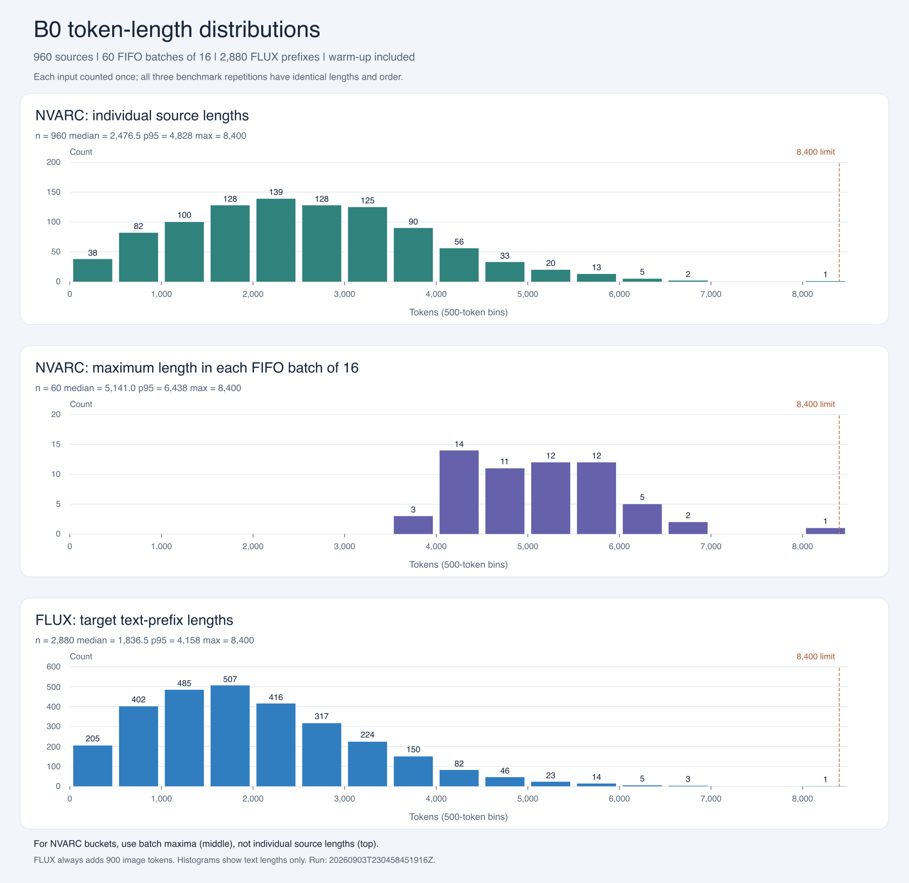

# B1 bucket policy

**Decision: implemented initial boundaries for B1.** The
[B1 configuration](../../configs/training/benchmarks/single_gpu_b1.json) selects
the policy below. The [completed B1 benchmark](README.md#b1-benchmark-result)
measured 11.9% more target throughput than B0; the
[profiler comparison](README.md#b1-profiler-findings-activity-gaps-and-total-ranges)
records the attention-plan and preparation costs. These boundaries are based
on the fixed B0 benchmark inputs; the combined B1 result does not establish
that they are a throughput optimum.

## Selected policy

- NVARC uses a fixed source batch of 16. Each source contributes three targets,
  giving the existing 48-target optimizer batch.
- FLUX keeps a microbatch size of one and adds 900 image tokens to each text
  prefix.
- NVARC-to-VAE preparation stays coupled. The fixed VAE microbatch size is 48,
  encoding the 48 target images from one NVARC batch in one VAE call.
- FIFO order, optimizer-batch membership, and loss weighting stay unchanged.
- Select the smallest configured boundary greater than or equal to the required
  length. For NVARC, that length is the maximum of the 16 consumed source
  lengths; for FLUX, it is the individual target's text-prefix length.
  Padding is masked; real tokens are not truncated to fit a bucket.

The final boundary of 8,400 covers the maximum consumed text length. Shorter
inputs use the smaller boundaries below; 8,400 is not a universal padding
length. Schema version 4 stores these lists in `padding.nvarc_bucket_boundaries`
and `padding.flux_bucket_boundaries`. Each field may be `null` to retain exact
padding; existing schema versions 1–3 disable bucket rounding by default.

## Data and histogram

The analysis uses B0 run `20260903T230458451916Z`, seed `167`, and its
[recorded step data](../../artifacts/benchmarks/20260903T230458451916Z/repetition-1/steps.jsonl).
The [benchmark overview](README.md#shared-benchmark-setup) describes the task
selection, augmentation, and execution protocol.

- 960 distinct source variants, with three target prefixes each: 2,880 targets.
- All 60 optimizer steps are included: 10 warm-up and 50 measured steps.
- Each input is counted once. Source keys, source lengths, target-prefix lengths,
  and their order match across all three repetitions.
- The recorded source order matches the benchmark's augmented-key file.
- NVARC lengths exclude the final stored output. They are the consumed prefix
  lengths, not the lengths of the complete stored token arrays.
- B0 used NVARC batch size one. The 60 NVARC batch maxima below are calculated
  for B1's consecutive groups of 16, preserving the recorded optimizer batches.

These are distributions of this benchmark subset, not of the entire training
pool or a held-out quality-evaluation split.

| Distribution | Count | Minimum | Median | p95 | Maximum |
| --- | ---: | ---: | ---: | ---: | ---: |
| Consumed NVARC source length | 960 | 160 | 2,476.5 | 4,828 | 8,400 |
| Maximum within each FIFO group of 16 sources | 60 | 3,688 | 5,141 | 6,438 | 8,400 |
| FLUX target text-prefix length | 2,880 | 86 | 1,836.5 | 4,158 | 8,400 |

The median is the usual middle-value average; p95 uses the nearest-rank method.
Histogram intervals are 500 tokens wide, with an inclusive upper edge. These
display bins are independent of the selected execution buckets.



Input SHA-256 values:

```text
repetition-1/steps.jsonl:
1422569fb812adf15c75cfccb7b3fdb074349d1f0647fed5a62ddee8b202f7b5

data/benchmarks/single_gpu_b0/splits/train/augmented_keys/train.json:
1cfcc5c80a64b59537fe09b04da9d0869862748ad5f3c2172b93516dc138c6eb
```

## NVARC boundaries

The seven selected boundaries are:

```json
[4096, 4608, 5120, 5632, 6144, 7168, 8400]
```

| Bucket upper bound (tokens per source) | Assigned batches of 16 |
| ---: | ---: |
| 4,096 | 3 |
| 4,608 | 16 |
| 5,120 | 10 |
| 5,632 | 12 |
| 6,144 | 14 |
| 7,168 | 4 |
| 8,400 | 1 |
| **Total** | **60** |

Only one group needs the 8,400-token bucket. The mean real batch maximum is
5,153.55 tokens; the mean selected boundary is 5,464.8 tokens.

Bucket rounding adds **6.04%** token positions relative to padding each group
only to its real maximum:

```text
sum(real batch maxima) = 309,213
sum(selected boundaries) = 327,888
extra positions = (327,888 / 309,213 - 1) * 100 = 6.04%
```

Both sums are multiplied by 16 for physical token-position counts. This
percentage describes only the additional bucket rounding. It does not include
the padding already caused by combining different source lengths in each
fixed FIFO batch.

The completed benchmark exposes that larger cost: during measurement steps
11–60, B1 processes 4,386,048 padded NVARC positions for 2,050,665 real tokens,
or **2.14x the real-token count**. This measurement window differs from the
60-step occupancy analysis above. The
[profiler comparison](README.md#b1-profiler-findings-activity-gaps-and-total-ranges)
discusses the increased NVARC GPU activity and the effects of padding and
mask handling.

## FLUX boundaries

The 19 selected text-prefix boundaries use 256-token increments through 3,072,
then 512-token increments through 5,120, followed by a coarser tail:

```json
[256, 512, 768, 1024, 1280, 1536, 1792, 2048, 2304, 2560, 2816, 3072,
 3584, 4096, 4608, 5120, 6144, 7168, 8400]
```

| Bucket upper bound (text tokens) | Assigned targets |
| ---: | ---: |
| 256 | 49 |
| 512 | 158 |
| 768 | 209 |
| 1,024 | 220 |
| 1,280 | 226 |
| 1,536 | 268 |
| 1,792 | 277 |
| 2,048 | 232 |
| 2,304 | 224 |
| 2,560 | 189 |
| 2,816 | 178 |
| 3,072 | 136 |
| 3,584 | 218 |
| 4,096 | 134 |
| 4,608 | 83 |
| 5,120 | 37 |
| 6,144 | 36 |
| 7,168 | 5 |
| 8,400 | 1 |
| **Total** | **2,880** |

At microbatch size one, each target corresponds to one FLUX forward. Its joint
sequence length is the selected text boundary plus 900 image tokens.

The policy maps 1,926 distinct real text-prefix lengths to 19 selected lengths.
The mean text length increases from 2,007.09 to 2,166.03 tokens, adding **7.92%**
text-token positions:

```text
sum(real text-prefix lengths) = 5,780,420
sum(selected text boundaries) = 6,238,160
extra text positions = (6,238,160 / 5,780,420 - 1) * 100 = 7.92%
```

The 900 image tokens are excluded from this percentage. It is not an estimate
of attention FLOPs, peak memory, or step-time overhead.

Warm-up inputs map to 18 of the 19 selected FLUX boundaries. Only 8,400 first
appears during measurement. These occupancy counts classify the recorded
input lengths; they are not direct cache-hit measurements. The separate B1
trace supports plan reuse: long FLUX cuDNN forward calls drop from 256 to two
over optimizer steps 5–7, with the same reduction in backward. A text boundary
is not necessarily a single cuDNN plan: block layouts and other cache-key
properties also matter.

## When an additional boundary is worthwhile

There is no universal minimum target count. A simple runtime break-even rule is:

```text
N * delta_t > C_extra
```

Here, `N` is the number of affected executions within the process being
considered, `delta_t` is their average steady-state time saving from the shorter
padded shape, and `C_extra` is the additional plan/setup cost over that horizon.
For FLUX training, time savings should include forward and backward execution.
Each benchmark repetition starts a fresh process, so reuse is assessed within
one repetition rather than pooling all three as one cache lifetime.

Frequency alone misses the gap to the next boundary. Removing exactly one
nonterminal boundary while keeping all other boundaries fixed would add:

| Removed FLUX boundary | Affected targets | Next boundary | Extra text-token positions |
| ---: | ---: | ---: | ---: |
| 1,024 | 220 | 1,280 | 220 x 256 = 56,320 |
| 3,584 | 218 | 4,096 | 218 x 512 = 111,616 |
| 7,168 | 5 | 8,400 | 5 x 1,232 = 6,160 |

These position counts are exact for the recorded inputs, but they are not time
savings. Attention cost also depends on sequence length, including the image
tokens, and GPU kernel behavior. The terminal boundary of 8,400 is required to
cover the maximum input; it has no larger configured boundary to merge into.

The [B0 profiler observation](README.md#profiler-observation-cudnn-attention-plan-setup)
motivates reducing the number of shapes, and the completed B1 trace confirms
that long setup calls nearly disappear. Neither result supplies isolated
`delta_t` and `C_extra` values for each possible boundary. The selected
boundaries define the evaluated B1 configuration; their throughput optimality
has not been established.

## Reproduce the bucket counts

Run from the repository root with the existing local B0 results. This command
uses only the Python standard library, prints its results, and writes no files:

```bash
python3 -B - <<'PY'
import bisect
import json
from pathlib import Path

path = Path("artifacts/benchmarks/20260903T230458451916Z/repetition-1/steps.jsonl")
rows = [json.loads(line) for line in path.open()]
nvarc = [4096, 4608, 5120, 5632, 6144, 7168, 8400]
flux = list(range(256, 3073, 256)) + [3584, 4096, 4608, 5120, 6144, 7168, 8400]
source_maxima = [max(s["tokens"] for s in r["prepared_sources"]) for r in rows]
prefixes = [length for r in rows for length in r["target_prefix_tokens"]]
assert len(rows) == 60
assert all(len(r["prepared_sources"]) == 16 and len(r["target_prefix_tokens"]) == 48
           for r in rows)
for name, lengths, boundaries in (("NVARC", source_maxima, nvarc),
                                   ("FLUX", prefixes, flux)):
    padded = [boundaries[bisect.bisect_left(boundaries, length)] for length in lengths]
    print(name, list(zip(boundaries, [padded.count(b) for b in boundaries])))
    print("Extra token positions (%):", 100 * (sum(padded) / sum(lengths) - 1))
PY
```
