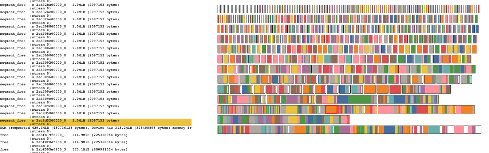
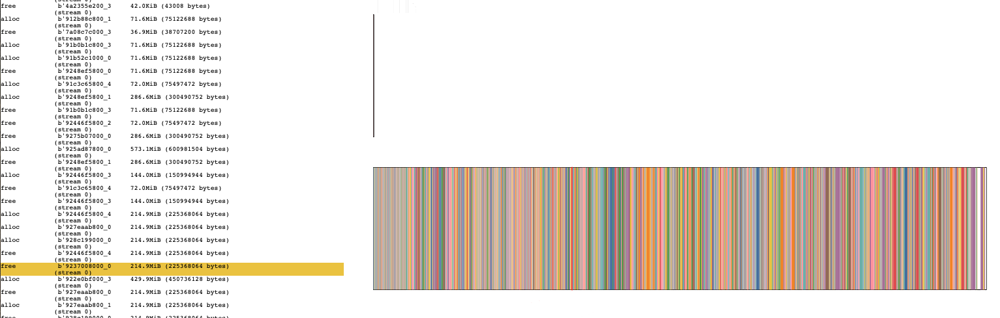
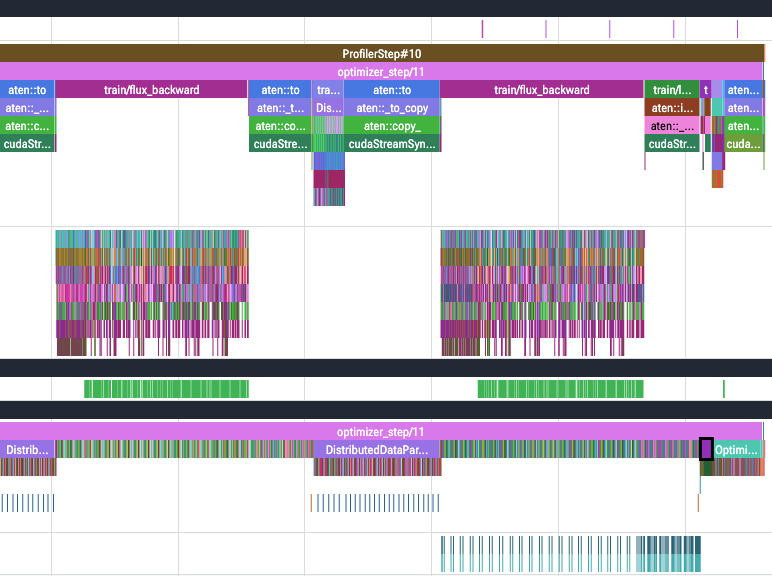

# DDP on two H200 GPUs

We extended the B3 training pipeline with standard DistributedDataParallel
(DDP). The implementation was straightforward, but early runs exposed memory
limits. We first shared gradient and communication storage, then changed FLUX
packing, and finally used memory snapshots to identify allocator fragmentation.

## DDP implementation

`torchrun` starts one process per GPU. Each process selects its device from
`LOCAL_RANK`, joins the NCCL process group and loads its own frozen NVARC and
VAE, plus the complete trainable FLUX transformer. DDP wraps the packed FLUX
forward; our sampler assigns complete sources to ranks. The global optimizer
batch remains 48 targets from 16 sources, split into 24 targets from 8 sources
per rank on two GPUs. The [DDP runner](../../src/diffusion_arc/training/ddp_runner.py)
connects these components.

Our main adaptation is gradient accumulation across several FLUX packs. The
[trainer](../../src/diffusion_arc/training/trainer.py) places both forward and
backward inside `no_sync()` for all but the final local pack. That final backward
synchronizes the accumulated gradients before each rank takes the same optimizer
step. Pack losses are weighted by target count so DDP averaging produces the
global mean gradient, even when ranks use different numbers of packs.

## Early OOMs: sharing gradient storage

The first memory change was `gradient_as_bucket_view=True`: parameter gradients
can share storage with DDP's all-reduce buckets instead of requiring separate
gradient and communication buffers. This does not preserve old gradient values;
it changes where gradients are stored
([PyTorch DDP documentation](https://docs.pytorch.org/docs/main/generated/torch.nn.parallel.DistributedDataParallel.html)).

Enabling the flag alone was insufficient: a one-GPU **DDP** smoke test still
failed during the second update. With `zero_grad(set_to_none=True)`, gradient
references were discarded between updates. The next `no_sync()` backward could
then allocate separate gradients while DDP retained its buckets. We changed the
DDP path to `zero_grad(set_to_none=False)`, which zeros gradients in place and
preserves established bucket views. Both the one- and two-GPU smoke tests then
completed three updates. The [accumulation probe](../../artifacts/ddp/bucket-view-accumulation.json)
records the difference; sharing becomes established during synchronized backward,
so initialization still has a different memory pattern.

## Rebalancing FLUX packs

The longer two-GPU benchmark subsequently failed in **step 29 on rank 1**.
We next changed the allocation of targets to **FLUX packs**, keeping the
12,288-token limit. These packs determine model calls; they are distinct from
DDP's gradient communication buckets.

The [revised planner](../training/flux-sequence-packing.md) first tries to reduce
the number of calls, then balances token counts at that call count. If a spread
of at most 1,000 tokens is feasible, it adjusts assignment and order to finish
sources earlier, weighted by the NVARC hidden-state bytes that can be released
after each source's last target. Otherwise it retains the balanced plan.
The largest pack always runs first. The search is bounded, so a globally minimal
call count or optimal ordering is not guaranteed for arbitrary inputs.

The next benchmark passed step 29 but failed in **step 54 on rank 0**. The later
failure showed that packing had not resolved the memory problem. We therefore
recorded allocator history while replaying the full training prefix to inspect
the failure itself.

## Diagnosing fragmentation

The snapshot located the OOM in **step 54, pack 1, during the first backward**:
`slice_backward` requested **429.9 MiB**. The error reported **7.91 GiB reserved
by PyTorch but unallocated**, yet the reconstructed largest free allocator gap
was at most **358.2 MiB**. CUDA itself reported only **313.2 MiB free**. Free
space was spread across blocks, and no available block could satisfy the request.

*Non-expandable allocator: free gaps remain between occupied blocks. The selected
event is the final `segment_free`, immediately before the OOM.*

Before reporting the OOM, **35 `segment_free` events returned 2 MiB each to
CUDA**. This matches the allocator's automatic retry path: release unused cached
segments and retry. It cannot relocate live tensors to combine holes in
partially occupied segments, so this cleanup was insufficient
([PyTorch allocator implementation](https://github.com/pytorch/pytorch/blob/main/c10/cuda/CUDACachingAllocator.cpp)).

## Enabling expandable segments

We then enabled `PYTORCH_ALLOC_CONF=expandable_segments:True`. This lets the
allocator grow segments by mapping additional physical memory into a reserved
virtual address range, reducing the need for separate segments with unusable
tails as allocation sizes change. Existing live tensors are not moved.
We kept the revised packing policy and the 12,288-token budget.

The diagnostic run replayed all 54 steps. Both ranks completed with zero
allocator retries and zero OOMs. The new snapshots, saved after the first
successful backward in step 54, retain the history needed to inspect the
corresponding allocation:

*Expandable allocator: the selected event immediately precedes
`alloc 922e0bf000_3`, the successful 429.9 MiB request. The dominant expandable
segment contains the allocations that previously occupied many separate segments.*

Configuration and workload were checked between the diagnostic runs. We aligned
the step/pack backward-start timestamps and compared the **first 41 allocation
request sizes in order**, excluding frees and segment-management events.
Request 41 fails in the old run and succeeds in the new one, with the same
`slice_backward` stack. Both screenshots precede that buffer's allocation, but
the old run has already released 70 MiB through its cleanup attempt. The views
scale independently, so their pixel areas are not directly comparable.

For a comparison before either allocation attempt or cleanup, the diagnostic
counters provide the same boundary: **rank 0, immediately before pack 1 backward**.

| Memory at that boundary | Non-expandable | Expandable |
| --- | ---: | ---: |
| PyTorch allocated | 129.72 GiB | 129.64 GiB |
| PyTorch reserved | 137.96 GiB | 133.05 GiB |
| CUDA device free | 0.24 GiB | 5.15 GiB |

Expandable segments left approximately **4.91 GiB more device memory free** with
nearly unchanged live allocations. This supports the fragmentation diagnosis;
it does not establish immunity to future OOMs. PyTorch snapshots also exclude
allocations made outside its allocator, such as some NCCL memory
([snapshot documentation](https://docs.pytorch.org/docs/main/torch_cuda_memory.html)).
The allocator change removed the need to lower the pack budget for this workload.
Balanced packing and largest-first ordering remain enabled; whether they are
still needed for memory stability could be checked by replaying the same prefix
with the previous planner and expandable segments enabled.

## Benchmark results

With the memory failure resolved for this workload, we ran the
[DDP benchmark configuration](../../configs/training/benchmarks/ddp_training.json)
in **three fresh process groups**, each with the same initialization and data
order, **10 warm-up steps and 50 measured steps**.

| Setting | Value |
| --- | --- |
| Hardware | 2 H200 GPUs, 139.80 GiB each; 16 CPU cores; 128 GiB host RAM |
| CPU threads | 8 per training process |
| Workload | Existing 960-source benchmark split; seed 167; 48 global targets per update |
| Precision | Frozen NVARC BF16, frozen VAE FP32, FLUX FP32 parameters with BF16 compute |
| Execution | FA3; revised FLUX packing; expandable segments; activation checkpointing disabled |
| Scope | Training only; validation, sampling, W&B and checkpoints omitted |

CUDA synchronization brackets data retrieval and the complete training step.
Each step uses the maximum rank duration; initialization, diagnostic aggregation
and separate profiling are excluded. Throughput is global target count divided
by total measured time.

| Repetition | Median step | p95 step | Targets/s |
| --- | ---: | ---: | ---: |
| 1 | 5.073 s | 5.879 s | 9.565 |
| 2 | 5.071 s | 5.888 s | 9.565 |
| 3 | 5.075 s | 5.880 s | 9.567 |
| **All 150 measured steps** | **5.073 s** | **5.892 s** | **9.566** |

All 180 updates, including warm-up, completed. The measured steps processed
7,200 targets in 752.681 s. Maximum per-GPU memory across both ranks and all
measured steps was **131.13 GiB allocated / 133.23 GiB reserved**.

### Comparison with single-GPU B3

Both [B3](b3.md) and DDP use the same 960-source benchmark split, a global batch
of 48 targets and three repetitions of 10 warm-up plus 50 measured steps.
The totals below cover all 150 measured steps; warm-up and initialization are
excluded. Memory is the maximum per GPU, not the sum across GPUs.

| Metric | B3: 1 H200 | DDP: 2 H200 |
| --- | ---: | ---: |
| Targets per update, global / per GPU | 48 / 48 | 48 / 24 |
| Measured target executions | 7,200 | 7,200 |
| Median step | 9.064 s | 5.073 s |
| p95 step | 10.630 s | 5.892 s |
| Total measured time | 1,371.33 s | 752.68 s |
| Targets/s | 5.250 | 9.566 |
| Peak allocated per GPU | 131.59 GiB | 131.13 GiB |
| Peak reserved per GPU | 137.44 GiB | 133.23 GiB |

Relative to the [B3 result](../../artifacts/benchmarks/20260910T034154977219Z/summary.json),
the two-GPU run delivers **1.82x throughput (+82.2%)** and takes **45.1% less
measured time** for the same target count. B3 used an earlier runner, packing
and randomness implementation, and allocator settings. This is an end-to-end
comparison of the two configurations, not an isolated measurement of DDP scaling.

## Separate Torch Profiler capture

A separate run recorded **step 11 after 10 warm-up steps**, on both ranks, with
CPU/CUDA tracing and shapes, memory and stack recording disabled. Each rank ran
six FLUX forward/backward packs. The traces expose NVARC, VAE, FLUX, optimizer
and NCCL activity; diagnostic collectives have separate phase labels. Trace
timings include instrumentation overhead and are not benchmark results.

*Left: an earlier backward accumulates gradients locally under `no_sync()`.
Right: the final backward also launches NCCL all-reduces, visible on the lower
GPU stream. These synchronize gradients accumulated across all packs. DDP
launches collectives bucket by bucket, allowing communication to overlap with
the remaining backward computation.*

## Numerical comparison

A separate check ran three actual updates with the current Trainer, first
without DDP on one H200, then with two DDP ranks. Both used the first 48 benchmark
sources (144 targets per variant), identical initial weights and verified actual
noise/timestep draws. Each variant performed its own NVARC/VAE preparation and
FLUX packing. The preregistered limits were 0.1% relative loss difference per step
and 5% full-gradient relative L2 difference before clipping in step one.

| Step | Plain single-GPU loss | Two-rank loss | Relative difference |
| --- | ---: | ---: | ---: |
| 1 | 0.36487508 | 0.36485884 | 0.00445% |
| 2 | 0.37960094 | 0.37961344 | 0.00329% |
| 3 | 0.35576326 | 0.35584247 | 0.02227% |

**All checks passed.** Across all 3,875,544,576 trainable gradient elements,
relative L2 difference was **0.4113%**, with cosine similarity **0.9999916**.
The largest reported block/group difference was 0.7676%. DDP gradient
fingerprints matched exactly in step one, parameter fingerprints matched after
every update, and frozen models remained unchanged with no gradients.
The [result and criteria](../../artifacts/ddp/20260921T210502329322Z-numerics-2gpu/training/summary.json)
and [execution manifest](../../artifacts/ddp/20260921T210502329322Z-numerics-2gpu/training/ddp/manifest.json)
retain the evidence. This checks three initial updates; it does not establish
long-run equivalence or explain the earlier step-42 divergence.

The next stage is FSDP2, using these two-GPU DDP results as the reference.
No additional DDP Nsight Systems capture is planned; this report contains no
four-GPU measurements.

## Evidence

Large artifacts remain local under `artifacts/ddp/` and in the Modal volume
`diffusion-arc-models`, environment `diffusion-arc`, under `results/ddp/<run-id>/`.
Manifests and launch records preserve configuration, package versions, commands,
source hashes and the uncommitted source state.

- Early smoke tests: [bucket views alone](../../artifacts/ddp/smoke-1gpu-bucket-view.log),
  then in-place zeroing on [one GPU](../../artifacts/ddp/smoke-1gpu-bucket-view-zero.log)
  and [two GPUs](../../artifacts/ddp/smoke-2gpu-bucket-view-zero.log).
  Benchmark failures: [step 29](../../artifacts/ddp/benchmark-2gpu-20260915T153801.log)
  and [step 54 after repacking](../../artifacts/ddp/benchmark-2gpu-balanced-20260916T105827Z.log).
- Benchmark `20260917T085250710411Z-benchmark-2gpu`:
  [combined summary](../../artifacts/ddp/20260917T085250710411Z-benchmark-2gpu/summary.json),
  [manifest](../../artifacts/ddp/20260917T085250710411Z-benchmark-2gpu/repetition-1/manifest.json),
  [launch record](../../artifacts/ddp/20260917T085250710411Z-benchmark-2gpu/launch.json).
- Memory runs `20260916T143445586047Z-memory-2gpu` and
  `20260917T112642809601Z-memory-2gpu`:
  [comparison](../../artifacts/ddp/20260917T112642809601Z-memory-2gpu/memory-comparison.json),
  [old OOM snapshot](../../artifacts/ddp/memory-2gpu-20260916-rank-0-oom.pickle),
  [new rank-0 snapshot](../../artifacts/ddp/20260917T112642809601Z-memory-2gpu/training/rank-0-step-54-pack-1-backward.pickle).
  Open snapshots in the [PyTorch Memory Visualizer](https://docs.pytorch.org/memory_viz).
- Torch Profiler `20260917T093703228054Z-profile-2gpu`:
  [rank 0](../../artifacts/ddp/20260917T093703228054Z-profile-2gpu/training/rank-0.trace.json.gz),
  [rank 1](../../artifacts/ddp/20260917T093703228054Z-profile-2gpu/training/rank-1.trace.json.gz),
  [trace validation](../../artifacts/ddp/20260917T093703228054Z-profile-2gpu/trace-validation.json).
