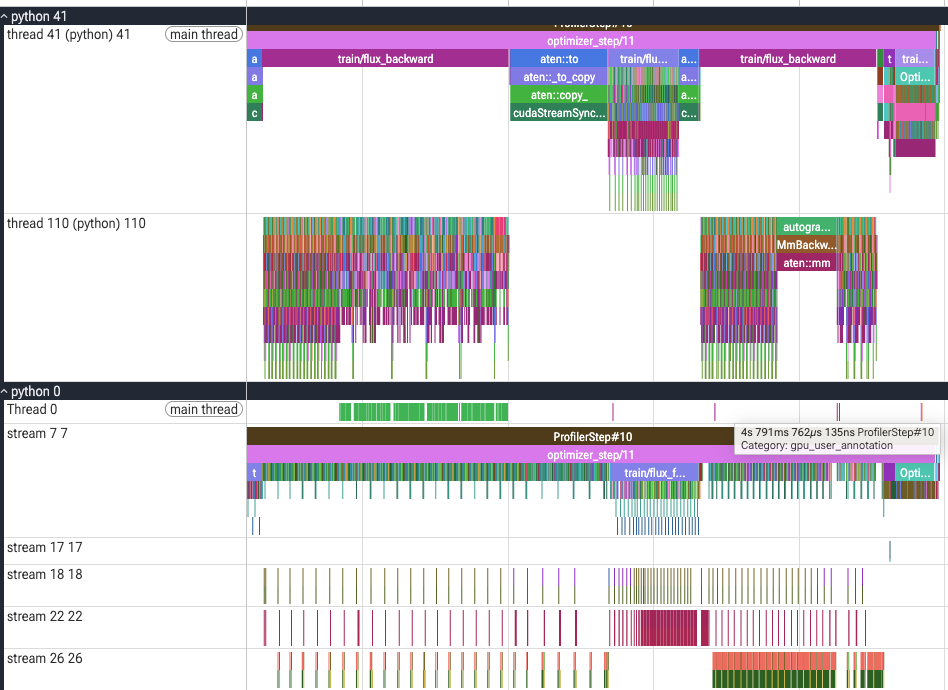

# FSDP2: from memory savings to balanced GPU execution

FSDP2 was introduced to free device memory by sharding trainable model state.
The first question was whether that memory could be converted into throughput
through larger FLUX packs. The measured gain was modest, so subsequent experiments
reduced communication and balanced work across GPUs. The strongest measured
combination is useful as a reference. Retesting the original sharding policy
with the improved batch planner made its 16k packs faster, but did not beat the
retained-weight 12k reference.

## What the initial FSDP2 policy saved

DDP replicates the complete trainable FLUX weights, gradients, and optimizer
state on each GPU. FSDP2 distributes those tensors across ranks. In the initial
policy, gradients are reduced and sharded after every microbatch; AdamW updates
the local parameter shards once per global optimizer batch.

FLUX has 3,875,544,576 trainable elements in these runs. With FP32 storage,
the approximate persistent tensor budgets on two GPUs are:

| Trainable state | DDP per GPU | Initial FSDP2 per GPU |
| --- | ---: | ---: |
| Parameter weights | 14.44 GiB | 7.22 GiB |
| Accumulated gradients | 14.44 GiB | 7.22 GiB |
| AdamW first and second moments | 28.88 GiB | 14.44 GiB |

AdamW's two moments track the moving averages of gradients and squared
gradients; small step counters are omitted here. These are persistent-state
estimates, not peak-memory predictions. Activations, gathered parameters,
communication buffers, frozen NVARC/VAE models, and allocator cache remain.

The trade-off is repeated communication during each FLUX microbatch:

1. AllGather the full block weights before forward.
2. Reshard after forward, releasing the gathered weights.
3. AllGather the weights again before backward.
4. ReduceScatter gradients after backward and accumulate local gradient shards.

Both GPUs still execute all transformer blocks on their own data. Sharding
does not assign whole layers to different GPUs. The packed root retains full
weights after forward; the block policy is the main setting varied here.

## Initial result: memory savings, lower throughput

The initial comparison used 12,288-token packs and three fresh repetitions per
configuration. Each run had ten warm-up and 50 measured optimizer updates.

| Initial configuration | Median step | Mean step | Targets/s | Peak allocated / GPU |
| --- | ---: | ---: | ---: | ---: |
| DDP reference | 5.073 s | 5.018 s | 9.566 | 131.13 GiB |
| FSDP2, forward resharding and per-microbatch reduction | 5.537 s | 5.511 s | 8.710 | 103.90 GiB |

FSDP2 freed **27.23 GiB of peak allocated memory per GPU**, while throughput
was **8.9% lower**. This supported the memory-saving objective, but did not
establish a speed advantage. Different local packing and source revisions make
this a complete-system comparison rather than an isolated sharding measurement.

The initial schedules also contained unequal real pack counts and **150 dummy
calls among 2,046 scheduled calls** in the measured window. Additional collectives,
dummy work, and rank imbalance were plausible costs. These observations do not
establish which cost caused the throughput gap.

## First hypothesis: fill the freed memory with larger packs

A pack budget limits the sum of text-prefix tokens and 900 image tokens per
target in one FLUX call. Increasing it can combine more targets into fewer
calls; it does not increase the 8,400-token source-context limit.

With the initial policy of forward resharding and reduction after every
microbatch, increasing capacity from **12,288 to 16,384** raised throughput from
**8.710 to 9.015 targets/s (+3.5%)**, with three repetitions per setting. Peak
allocated memory rose from **103.90 to 123.46 GiB**. Scheduled calls per
rank/update fell from **6.82 to 5.22**, including dummy calls. Fewer calls did
not produce a proportional throughput improvement.

The larger packs used much of the freed memory, but delivered only a modest
speed increase. The reduction in call count could not be treated as an equal
reduction in computation or exposed communication time. This motivated changing
the communication schedule and then examining rank balance. It did not prove
that larger packs are ineffective under a better-balanced schedule.

## Second hypothesis: reduce repeated communication

Forward resharding releases gathered block weights after forward, requiring
another AllGather before backward. Disabling it retains weights for backward
and removes that gather, at the cost of higher live parameter memory. The
packed root retains its weights after forward in both policies. Parameters
reshard after backward, so later microbatch AllGathers remain.

Initial runs synchronized gradients after every microbatch and accumulated
gradient shards. Later runs retain full local gradients until the last scheduled
call, including a dummy call when needed, then reduce before clipping and
AdamW. This reduces communication frequency but increases memory.

The experiments tested forward retention alone at 14,336 tokens, batch-end
reduction with forward resharding at 15,360, and their combination at 12,288.
Because these runs use different budgets, their timings do not isolate the cost
of either policy. The fastest measured combination retains forward weights and
uses batch-end reduction. Its implementation is in
[`shard_flux` and `FsdpStrategy`](../../src/diffusion_arc/training/distribution_strategy/fsdp.py).

Retaining full weights or full local gradients gives back part of the initial
memory saving. The policy and usable pack budget must therefore be considered
together. The combined retained-weight, batch-end-reduction configuration used
12,288 tokens as a conservative complete-pipeline budget.

## Third hypothesis: balance the work at synchronization points

### Source assignment across GPUs

Original assignment gives each GPU eight complete sources. Token balancing
sorts sources by the sum of eligible prefix lengths plus image tokens and assigns
each to the least-loaded rank. All targets of one source stay on one GPU, while
source counts can differ. Local packing remains a separate problem.

At 12,288 tokens, with retained forward weights and batch-end reduction:

| Assignment and packing | Median step | Mean step | Targets/s |
| --- | ---: | ---: | ---: |
| Fixed source assignment; local packing | 5.288 s | 5.281 s | 9.088 |
| Sources balanced by tokens; local packing | 4.834 s | 4.889 s | 9.819 |
| Joint source assignment and aligned CPU pack plans | 4.739 s | 4.796 s | 10.009 |

Token-balanced assignment reduced mean step time by **7.4%** in these runs.
It was the largest subsequent gain in the tested combined-policy configuration.
The same source-assignment approach is used by the latest DDP reference.

### Joint planning of parallel microbatches

Balancing total tokens per GPU does not guarantee balanced simultaneous calls.
The joint planner also optimizes pack contents and order across ranks, while
retaining whole-source ownership and global target identities. Its search is
bounded and does not guarantee a global optimum. Token counts are a cost proxy,
not measurements of attention time.

Precomputed plans carry the common FSDP call count, replacing the GPU MAX
AllReduce previously used to agree on that count. Dummy calls can still be
scheduled on the CPU. Loss checks and gradient-norm collectives remain.

In the optimized 12k run, scheduled calls per rank/update fell from **6.32 to
6.20**, and measured-window dummy calls from **five to zero**. Aligned packs
differed by **5.46 tokens on average**, with a maximum of 44. All 60 executed
source assignments, prefix lengths, and call counts matched the saved plans.

Mean step time fell **1.9%** and throughput rose **1.94%**; 47 of 50 matching
steps were faster. Peak allocated memory stayed essentially unchanged.
This gain combines assignment, packing, order, and CPU scheduling; these
measurements do not separate their individual time contributions.

The effect was smaller and less clear with forward resharding and 14,336-token
packs: local packing measured **4.857 s median / 4.941 s mean**, while joint
planning measured **4.835 s / 4.987 s**. Three unusually slow steps affected
the joint run's mean. Removing those same steps from both runs reverses the
mean comparison, but is only a sensitivity check. Primary results include all
steps, and the outlier cause is unresolved. Planning benefits therefore depend
on the execution policy and budget.

### Grouping transformer blocks

Five-block groups were tested with forward resharding, batch-end reduction,
token-balanced sources, and 14,336-token packs. A separate profiler run recorded
step 11 after ten preceding updates. Its full recorded step took **5.143 s**,
versus **4.572 s** for one-block groups under the same settings.

These are instrumented single steps, not benchmark medians. They do not establish
a throughput benefit from grouping, even if individual forward regions improve.
The selected reference retains one block per group; a complete grouped-block
benchmark remains unmeasured.

## Revisit the original policy with the improved planner

The joint planner changes which ranks reach collective operations together.
Earlier communication-policy results were obtained with a different assignment
and local packing. They do not establish that minimizing communication remains
the best choice after the planner changes.

This is the current coverage with jointly precomputed CPU plans:

| Forward resharding | Gradient reduction | Joint-plan benchmark evidence |
| --- | --- | --- |
| Enabled | Every microbatch | 16,384 tokens: 4.978 s median / 5.011 s mean |
| Disabled | Every microbatch | Missing |
| Enabled | Optimizer-batch end | 14,336 tokens: 4.835 s median / 4.987 s mean |
| Disabled | Optimizer-batch end | 12,288 tokens: 4.739 s median / 4.796 s mean; 13,312 degraded |

A smaller token imbalance may reduce rank waiting, but does not reduce the
bytes transferred by a given AllGather or ReduceScatter. Equal token totals are
also an imperfect proxy for equal compute time. Improved packing therefore
makes the original policy worth retesting; it does not establish that its
communication will be cheap enough to win.

The retest used **forward resharding enabled, gradient reduction after every
microbatch, 16,384-token packs, and joint CPU plans**. One fresh repetition
completed ten warm-up and 50 measured updates on two H200 GPUs, with one block
per FSDP group and 48 targets per optimizer batch. Its manifest records the
requested policy, and all 60 executed schedules matched the saved plans and
the reference runs' global workload. No allocator OOM warnings were logged.

| Original-policy 16k comparison | Median step | Mean step | Targets/s | Peak allocated / GPU |
| --- | ---: | ---: | ---: | ---: |
| Historical fixed-source assignment and local packing; three repetitions | 5.300 s | 5.325 s | 9.015 | 123.46 GiB |
| Joint CPU plans; one repetition | 4.978 s | 5.011 s | 9.579 | 123.35 GiB |

Throughput improved **6.3%** against the historical 16k run. Scheduled calls
per rank/update fell from **5.22 to 4.78**, while real calls fell only from
**4.83 to 4.78**: eliminating dummy work accounts for most of the call-count
change. The new measured window had no dummy calls and an average aligned
pack difference of **2.71 tokens**, with a maximum of 49. Planning all 60 batches
took **3.02 s**, excluded from step timing. Peak reserved memory was **128.74 GiB**.

Despite **22.9% fewer calls** than the retained-weight 12k reference, this run
had **4.5% higher mean step time** and **4.3% lower throughput**. All 50 matching
measured steps were slower. Compared with token-balanced DDP, throughput was
**5.3% lower**. Improved scheduling helped the original policy, but the extra
communication and larger packs together did not win at this budget. These
measurements do not isolate communication time from packing and compute costs.

For a strict packing-only comparison, replay the original policy with and
without joint plans using the same current code and budget. Comparing the new
run only with historical results instead measures the revised system. Select
further policy/budget combinations according to the measured result rather than
assuming that the retained-weight policy is settled.

Regular training and existing benchmark configurations default to batch-end
gradient synchronization. Reusing the historical 16k JSON alone would therefore
run a different policy. The prepared
[original-policy experiment with joint plans](../../configs/training/benchmarks/fsdp2_16k_per_microbatch_sync_precomputed_packing.json)
explicitly sets the benchmark-only `fsdp_gradient_sync="per_microbatch"` control.
Its policy is recorded in the manifest; the regular training default is unchanged.
Numerical and capacity diagnostics reject this override rather than ignoring it.

## Best measured combination so far

The fastest tested FSDP2 configuration retains forward weights, reduces
gradients at the optimizer-batch end, and uses joint CPU plans at 12,288 tokens.
It reaches **10.009 targets/s**, about **1.0% below token-balanced DDP**, with
**6.51 GiB less peak allocated memory per GPU**. This is the best measured
combination in the explored cases, not an optimum over the missing cases above.

| Current reference | Median step | Mean step | Targets/s | Peak allocated / GPU | Peak reserved / GPU |
| --- | ---: | ---: | ---: | ---: | ---: |
| **Retained-weight FSDP2 with joint CPU plans** | **4.739 s** | **4.796 s** | **10.009** | **124.35 GiB** | **136.72 GiB** |
| Token-balanced DDP | 4.677 s | 4.747 s | 10.111 | 130.86 GiB | 133.11 GiB |

Both use 12,288-token packs and one fresh repetition of 50 measured updates.
The approximately 1% gap remains provisional. The
[measured FSDP2 reference configuration](../../configs/training/benchmarks/fsdp2_12k_no_forward_reshard_precomputed_packing.json)
records:

- `flux_max_joint_tokens=12288`;
- `fsdp_reshard_after_forward=false`;
- gradient synchronization in the final scheduled microbatch;
- one transformer block per FSDP group;
- whole-source ownership with joint, precomputed microbatch plans;
- no activation checkpointing.

Full parameters are still gathered before each microbatch and resharded after
backward. Earlier calls retain full local gradients, so this policy preserves
less of the initial gradient-memory saving.

## Measurement contract

Complete runs use two H200 GPUs, 16 allocated CPU cores, 128 GiB host RAM,
and the same 960-source prepared view. Each optimizer batch contains 48 targets
from 16 sources. Seed `167` and `global_step_target_v1` preserve global batch
membership and indexed noise/timestep draws when ownership changes. Actual
source keys, target-prefix lengths, endpoint counts, and learning rates were
compared across the latest runs.

NVARC is frozen in BF16 and the VAE in FP32. FLUX has FP32 parameters and
reductions with BF16 compute, FA3 attention, and no activation checkpointing.
The recorded runtime uses PyTorch 2.13.0, CUDA 13.0, and expandable allocator
segments. DDP uses `balanced_release_v1` local packing; initial FSDP2 planners
use `legacy_bfd_v1`, while joint precomputation replaces local pack selection
in the optimized run.

Fresh worker processes start from the same base initialization. Ten warm-up
updates precede 50 measured updates. Timing uses CUDA synchronization around
data retrieval and the complete training step, then takes the slowest rank per
step. The outer barrier, diagnostic-record aggregation, model loading,
validation, sampling, W&B, and checkpoints are excluded. Mean step time is total
measured time divided by measured steps; throughput is total targets divided by
that time. Repeated runs are pooled before computing the median and p95.

Memory values are maxima on one GPU over the measured window. Reserved memory
includes reusable allocator cache; allocated-memory savings do not directly
equal additional free device memory. Allocations outside PyTorch's allocator,
including some NCCL buffers, are not included.

Joint plans are computed before the timed loop. The optimized 12k run spent
**3.55 s** planning all 60 batches, excluded from throughput. This measures GPU
execution with prepared plans; dynamic background planning has not been
measured on GPUs. Regular training now supports `joint_packing_v1`, which uses
the same planner through bounded spawned CPU workers; see the
[training guide](../training/README.md).

## The 13k memory-pressure run

Increasing only the optimized reference's budget from **12,288 to 13,312** produced
**170 allocator OOM mapping warnings**, 85 per rank. Every completed step from
2 through 43 had four warnings; two more followed the last completed step.
The user interrupted the run after 43 updates, including 33 measured steps.
There was no logged terminal CUDA `OutOfMemoryError`; updates continued under
persistent memory pressure.

| Same 33 measured steps | Median step | Mean step | Peak allocated / GPU | Peak reserved / GPU |
| --- | ---: | ---: | ---: | ---: |
| Optimized reference, 12,288 tokens | 4.768 s | 4.800 s | 124.32 GiB | 136.69 GiB |
| Interrupted run, 13,312 tokens | 12.542 s | 17.228 s | 129.27 GiB | 138.19 GiB |

The approximately **3.6x mean slowdown** makes 13,312 unsuitable for this
configuration and workload. This is an incomplete, degraded run, not a completed
benchmark or an exact universal capacity boundary. The short synthetic probe
had not established sustained full-pipeline stability. The selected reference
remains 12,288 tokens.

## Numerical evidence and limits

The initial three-update diagnostic compared actual Trainer execution on one GPU,
DDP, and FSDP2 with verified inputs and indexed draws. Full gradients were
compared only in the first step, before clipping.

| Comparison | Step-one gradient relative L2 | Maximum relative loss difference | Recorded gate |
| --- | ---: | ---: | --- |
| Single GPU / DDP | 0.364% | 0.052% | Passed |
| Single GPU / FSDP2 | 0.364% | 0.123% | Failed: step-three loss |
| DDP / FSDP2 | 0.221% | 0.071% | Passed |

The predefined loss limit was **0.1%** and the gradient relative L2 limit **5%**.
The single-GPU/FSDP2 loss result remains a failed gate; small observed differences
alone do not change that criterion. The diagnostic did not directly compare
AdamW moments or parameter updates across strategies and does not establish
long-run convergence. The latest communication and precomputed-packing combination
has not received a matching dedicated GPU gradient/update comparison.

Historical 60-update loss comparisons found similar average differences across
strategies and across repetitions of the same strategy. Initial 12k FSDP2 versus
historical DDP averaged 0.43%, with a 3.80% maximum; 16k versus initial 12k averaged
0.49%, with a 6.06% maximum. A larger single-GPU discrepancy at step 42 already
existed in the DDP comparison. These logs are descriptive evidence, not
gradient/update equivalence tests.

## Profiler interpretation

The initial profiler recorded step 11 after ten warm-up updates. The stream
roles below refer to rank 0, with six forward/backward calls and reduction
after every microbatch. Stream IDs are capture-specific.

| CUDA stream | Recorded work | Role |
| --- | --- | --- |
| 7 | Model/optimizer kernels, copies, parameter copy-out | Main computation |
| 18 | 306 `multi_tensor_apply_kernel` copies from `aten::_foreach_copy_` | Fill AllGather input buffers from local shards |
| 22 | 306 NCCL AllGather kernels | Assemble full block parameters |
| 26 | 156 NCCL ReduceScatter kernels and 845 additions | Reduce and accumulate gradient shards |
| 17 | One FP32 AllReduce of 169 elements, about 5.5 microseconds | Gradient norm inside `train/clip_grad` |

Stream 18's `FSDP::all_gather` ranges contain local copies; stream 22 performs
communication. CPU phase bars span work and waiting, rather than continuous
GPU execution. Kernel times on different streams must not be summed as exposed
communication overhead because they overlap; NCCL duration can also include
waiting for another rank. Quantifying compute gaps and rank waiting requires
interval analysis beyond call counts alone.

Later 14k and five-block captures are separate diagnostics. Individual step
times and forward-region observations do not replace complete-step benchmarks.
The 600 ms tail reported during the earlier 15k investigation has not been
established as an isolated FSDP communication cost.

## Implications

For this two-GPU workload, use retained-weight 12k FSDP2 with joint plans and
token-balanced DDP as measured references. The original-policy 16k retest did
not displace them; forward retention with per-microbatch reduction remains
unmeasured with joint plans. Source balancing transfers to both strategies.
Joint planning adds a measured gain with retained weights, while its startup
cost is excluded. Bounded background planning is now implemented for regular
training with the same source and target identities. CPU tests cover 1/2/4/8
rank plans and actual optimizer updates; its GPU throughput remains unmeasured.

Memory and communication settings should be reassessed together when scaling
to four or eight GPUs and larger global batches. Current results establish
neither that DDP remains faster at those sizes nor that larger FSDP packs become
beneficial. Activation checkpointing and other precision policies were not
tested. Numerical validation of the final combination and exposed communication
analysis remain separate from throughput measurements.

## Evidence

Complete run directories contain summaries, step records, and a
`repetition-1/manifest.json` recording effective settings, hardware/software,
data identity, and source identity. Source hashes cover configurations as well
as code; differing hashes alone do not identify which changed. Larger artifacts
remain local and on Modal, outside Git.

| Experiment | Configuration | Result / diagnostic |
| --- | --- | --- |
| Initial 12k, per-microbatch reduction | [Config](../../configs/training/benchmarks/fsdp2_training.json) | [Three-run summary](../../artifacts/fsdp2/20261006T073103320421Z-benchmark-2gpu/summary.json) |
| Initial 16k, per-microbatch reduction | [Config](../../configs/training/benchmarks/b6_fsdp2_16k.json) | [Three-run summary](../../artifacts/fsdp2/20261006T085059072341Z-benchmark-2gpu/summary.json) |
| Forward retention, 14k | [Config](../../configs/training/benchmarks/b7_fsdp2_14k_no_forward_reshard.json) | [Three-run summary](../../artifacts/fsdp2/20261006T145047036767Z-benchmark-2gpu/summary.json) |
| Batch-end reduction, forward resharding, 15k | [Config](../../configs/training/benchmarks/b8_fsdp2_15k.json) | [One completed repetition; series interrupted](../../artifacts/fsdp2/20261006T215425195432Z-benchmark-2gpu/summary.json) |
| Combined policy, fixed sources, 12k | [Config](../../configs/training/benchmarks/b9_fsdp2_12k_no_forward_reshard.json) | [Summary](../../artifacts/fsdp2/20261006T232626086904Z-benchmark-2gpu/summary.json) |
| Combined policy, token-balanced sources, 12k | [Config](../../configs/training/benchmarks/b10_fsdp2_12k_token_balanced.json) | [Summary](../../artifacts/fsdp2/20261007T033001881196Z-benchmark-2gpu/summary.json) |
| DDP, token-balanced sources, 12k | [Config](../../configs/training/benchmarks/b11_ddp_12k_token_balanced.json) | [Summary](../../artifacts/ddp/20261007T035232492085Z-benchmark-2gpu/summary.json) |
| Forward resharding, token-balanced sources, 15k | [Config](../../configs/training/benchmarks/b12_fsdp2_15k_token_balanced.json) | [Summary](../../artifacts/fsdp2/20261007T040411840183Z-benchmark-2gpu/summary.json) |
| Forward resharding, token-balanced sources, 14k | [Config](../../configs/training/benchmarks/b13_fsdp2_14k_token_balanced.json) | [Summary](../../artifacts/fsdp2/20261012T073049251756Z-benchmark-2gpu/summary.json), [profile steps](../../artifacts/fsdp2/20261008T004446738063Z-profile-2gpu/training/steps.jsonl) |
| Five-block groups, 14k | [Config](../../configs/training/benchmarks/b14_fsdp2_14k_grouped_blocks.json) | [Profile steps](../../artifacts/fsdp2/20261008T034040697531Z-profile-2gpu/training/steps.jsonl) |
| Forward resharding, joint CPU plans, 14k | [Config](../../configs/training/benchmarks/b15_fsdp2_14k_precomputed_packing.json) | [Summary](../../artifacts/fsdp2/20261009T132741277043Z-benchmark-2gpu/summary.json) |
| Original-policy retest: forward resharding, per-microbatch reduction, joint CPU plans, 16k | [Config](../../configs/training/benchmarks/fsdp2_16k_per_microbatch_sync_precomputed_packing.json) | [Summary](../../artifacts/fsdp2/20261012T143222705996Z-benchmark-2gpu/summary.json), [plans](../../artifacts/fsdp2/20261012T143222705996Z-benchmark-2gpu/repetition-1/packing_plans.json), [console](../../artifacts/fsdp2/20261012T143222705996Z-benchmark-2gpu/console.log) |
| **Optimized reference: retained weights, joint CPU plans, 12k** | [Config](../../configs/training/benchmarks/fsdp2_12k_no_forward_reshard_precomputed_packing.json) | [Summary](../../artifacts/fsdp2/20261012T091554700591Z-benchmark-2gpu/summary.json), [plans](../../artifacts/fsdp2/20261012T091554700591Z-benchmark-2gpu/repetition-1/packing_plans.json) |
| Interrupted 13k memory-pressure run | [Config](../../configs/training/benchmarks/fsdp2_13k_no_forward_reshard_precomputed_packing.json) | [Steps](../../artifacts/fsdp2/20261012T100748789698Z-benchmark-2gpu/repetition-1/steps.jsonl), [console](../../artifacts/fsdp2/20261012T100748789698Z-benchmark-2gpu/console.log) |

Additional evidence:

- [Initial numerical diagnostic](../../artifacts/fsdp2/20261006T063602172979Z-numerics-2gpu/training/summary.json).
- [Initial-policy capacity probe](../../artifacts/flux-capacity/20261006T082941914783Z/summary.json),
  [forward-retention probe](../../artifacts/flux-capacity/20261006T143519497622Z/summary.json),
  and [combined-policy probe](../../artifacts/flux-capacity/20261006T231257954543Z/summary.json).
- [Initial rank-0 trace](../../rank-0.trace.json.gz), [rank-1 trace](../../rank-1.trace.json.gz),
  and [DDP rank-0 trace](../../rank-0_ddp.trace.json.gz).
- [Historical DDP benchmark](../../artifacts/retired-worktrees/ddp-7b16/artifacts/ddp/20260917T085250710411Z-benchmark-2gpu/summary.json)
  and [single-GPU loss records](../../artifacts/retired-worktrees/ddp-7b16/artifacts/ddp/benchmark-1gpu-20260915T153715-steps.jsonl).

Modal artifacts use Volume `diffusion-arc-models` in environment `diffusion-arc`,
under `results/ddp/<dated-run-id>/`, with numerical diagnostics under
`results/fsdp2/`. Historical directory names do not specify execution strategy.
