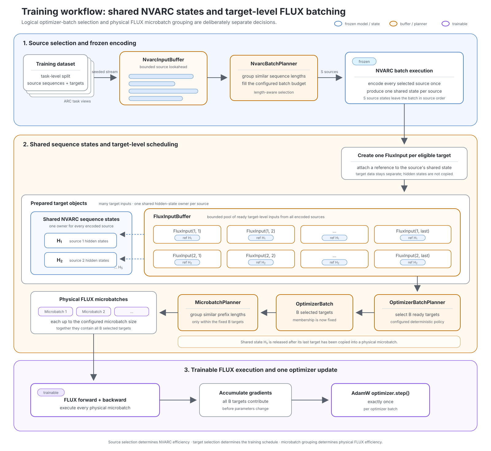

# Training System Overview

## Scope

This page explains the overall Diffusion-ARC training flow and links to the
relevant code and detailed documentation. The root
[`README.md`](../../README.md) remains authoritative for project scope,
milestones, evaluation, and non-goals.

## Overall workflow



**Encode each source once. Train its eligible targets from the shared state.**

NVARC and FLUX have different batching needs, so they are scheduled separately.
NVARC encodes each source sequence once. Every eligible target becomes a
`FluxInput` that references the shared sequence state and selects only the
prefix it needs. The buffer lets FLUX form optimizer batches and
length-compatible microbatches without running NVARC again.

The optimizer-batch planner chooses which targets contribute to the next
update. Its selection policy is part of the experiment because it can change
the training schedule. The microbatch planner only decides how those fixed
targets are executed; it does not change optimizer-batch membership.

The diagram shows the target scheduler. The current FIFO baseline is summarized
below. Frozen VAE target encoding is omitted from the diagram for clarity.

## Current baseline and target scheduler

| Area | Current single-GPU baseline | Target scheduler shown above |
| --- | --- | --- |
| Source scheduling | Read an ordered `DataLoader` stream in fixed consecutive source batches. | Keep a bounded lookahead of source sequences. |
| NVARC batching | Run up to the configured number of consecutive sources per padded NVARC forward. | Group similar-length sources into one NVARC batch. |
| Target buffering | Append prepared targets to a private FIFO queue. | Keep a bounded pool of ready targets from several encoded sources. |
| Optimizer batch | Take the next targets in FIFO order. | Select ready targets with a configured deterministic policy. |
| FLUX microbatches | Split the optimizer batch into contiguous chunks. | Group targets with similar prefix lengths inside the fixed optimizer batch. |

Both paths accumulate gradients across all physical microbatches and perform
exactly one AdamW update for each optimizer batch.

The current entrypoint is
[`scripts/train_single_gpu.py`](../../scripts/train_single_gpu.py). Its
`DataLoader` uses `batch_size=None`, so the runner receives one
`ArcTokenizedTrainingSample` at a time. The training loop groups consecutive
items according to `nvarc_source_batch_size`; this does not invoke
`TrainingCollator` or construct `PackedTrainingBatch` objects. Eligible target
images from that group are encoded in chunks bounded by
`vae_microbatch_size`.

## Model boundaries

| Component | State | Role |
| --- | --- | --- |
| NVARC/Qwen3-4B | Frozen | Encode complete ARC source sequences. |
| FLUX.2 VAE | Frozen | Encode target canvases into clean image latents. |
| FLUX.2 transformer | Fully trainable | Predict flow velocity from noisy image latents and NVARC conditioning. |
| AdamW | FLUX parameters only | Update the complete FLUX transformer. |

NVARC and the VAE run without training autograd graphs. FLUX parameters and
optimizer state remain FP32, the FLUX forward uses BF16 autocast, and the loss
is reduced in FP32.

## Core objects

| Object | Meaning |
| --- | --- |
| `ArcTokenizedTrainingSample` | One complete tokenized ARC source sequence with its recorded target positions and grids. |
| `NvarcInputBuffer` | Source sequences waiting for length-aware NVARC selection. |
| `NvarcBatch` | The source sequences selected for one frozen NVARC forward. |
| `NvarcSequenceState` | One source's NVARC hidden states, shared by all of its eligible target inputs. |
| `FluxInput` | One target, its exact prefix boundary, its clean latent, and a reference to the shared sequence state. |
| `FluxInputBuffer` | Prepared target inputs waiting for optimizer-batch selection. |
| `OptimizerBatch` | All targets that contribute to one parameter update. |
| `FluxMicrobatch` | A physical subset of the optimizer batch processed in one FLUX forward and backward pass. |

The shared hidden-state tensor is released after its last target prefix has been
copied into a physical microbatch. Python later collects the small
`NvarcSequenceState` object when no `FluxInput` references it anymore.

Microbatch losses are weighted by target count, so changing the physical
grouping does not change the optimizer update. The detailed batching rules and
loss normalization are documented in the
[`batching-and-efficiency-roadmap.md`](batching-and-efficiency-roadmap.md).

## Training module map

| Module | Responsibility |
| --- | --- |
| [`dataset.py`](../../src/diffusion_arc/training/dataset.py) | Build tokenized ARC training samples from configured task views. |
| [`collation.py`](../../src/diffusion_arc/training/collation.py) | Provide the auxiliary packed CPU batch used by tests and diagnostics. |
| [`single_gpu_config.py`](../../src/diffusion_arc/training/single_gpu_config.py) | Validate model, data, loop, and optimizer settings. |
| [`single_gpu_setup.py`](../../src/diffusion_arc/training/single_gpu_setup.py) | Select the device, seed RNGs, load models, and construct the training components. |
| [`flux_input.py`](../../src/diffusion_arc/training/flux_input.py) | Create target-level inputs from frozen NVARC and VAE outputs. |
| [`flux_microbatch.py`](../../src/diffusion_arc/training/flux_microbatch.py) | Copy exact prefixes and build physical FLUX microbatches. |
| [`flux_loss.py`](../../src/diffusion_arc/training/flux_loss.py) | Sample flow states, run FLUX, and compute the velocity loss. |
| [`single_gpu_loop.py`](../../src/diffusion_arc/training/single_gpu_loop.py) | Run the FIFO baseline, accumulate gradients, and update FLUX. |
| [`flow_probes.py`](../../src/diffusion_arc/training/flow_probes.py) | Measure comparable fixed-noise flow losses. |
| [`__init__.py`](../../src/diffusion_arc/training/__init__.py) | Define the public training-package exports. |

## Further reading

| Document | Details |
| --- | --- |
| [`../data/data-pipeline.md`](../data/data-pipeline.md) | ARC loading, task splits, augmentation, prompts, tokenization, and target canvases. |
| [`../data/training-data-assembly.md`](../data/training-data-assembly.md) | The auxiliary `TrainingCollator` and `PackedTrainingBatch` contract. |
| [`nvarc-batch-runner.md`](nvarc-batch-runner.md) | Frozen NVARC batching, masking, layer selection, and checkpoint evidence. |
| [`flux-text-conditioning.md`](flux-text-conditioning.md) | Exact prefixes, text position IDs, masks, and hidden-state ownership. |
| [`flux-image-encoding.md`](flux-image-encoding.md) | Frozen VAE target encoding, latent packing, and normalization. |
| [`flow-matching.md`](flow-matching.md) | Flow sampling, velocity supervision, loss computation, and validation. |
| [`batching-and-efficiency-roadmap.md`](batching-and-efficiency-roadmap.md) | FIFO details, the target scheduler, batching invariants, and optimization gates. |

## Validation

Run the local unit-test suite with:

```bash
PYTHONDONTWRITEBYTECODE=1 PYTHONPATH=src \
  .venv/bin/python -B -m unittest discover -s tests
```

The local tests cover tensor contracts, hidden-state ownership, loss weighting,
step limits, and tail handling. Real checkpoints and backend-specific behavior
remain explicit smoke or preflight tests.

## Current boundaries

- Training is single-process and single-GPU; DDP and FSDP2 are not implemented.
- The length-aware two-buffer scheduler shown above is not implemented; fixed
  consecutive source batching remains part of the FIFO baseline.
- Training configuration schema v2 adds explicit NVARC source and VAE physical
  batch sizes. Schema v1 remains supported as the original single-source
  compatibility mode.
- Durable telemetry, checkpoint writing, and resume support remain future work.
- The packed `TrainingCollator` path is not used by the current training
  entrypoint.
